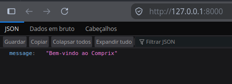
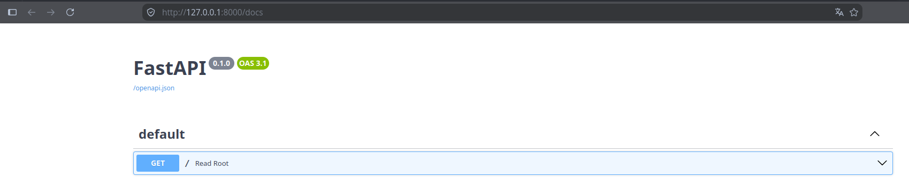

# :lucide-monitor-cloud: App

Vamos criar nosso primeiro arquivo python, que será o principal da nossa aplicação, será o arquivo **app.py**, através dele será inicializado nossa aplicação para as demais rotas e funções do nosso sistema.

``` Projeto hl_lines="2" title="app.py"
├── comprix
    |  └── app.py  
    │  └── __init__.py
    ├── pyproject.toml
    ├── README.md
    └── tests
       └── __init__.py

```

## Primeira rota

Antes de criar as funcionalidades do Comprix, vamos entender o código mínimo de uma aplicação FastAPI: uma API com um único endereço que responde com uma mensagem de boas-vindas.


```python title="comprix/app.py" linenums="1" hl_lines="6 7 8"
from fastapi import FastAPI

app = FastAPI()


@app.get('/')
def read_root():
    return {'message': 'Bem-vindo ao Comprix'}
```

Na linha 1, importando a biblioteca do FastAPI.

Na linha 2, Cria a aplicação e a guarda na variável app. É esse objeto que recebe as requisições e decide o que responder.

??? info "Por que o nome app?" 
    O comando fastapi dev comprix/app.py, procura uma variável chamada app dentro do arquivo.

Agora vamos executar o comando abaixo no nosso terminal, o comando abaixo:

**fastapi dev comprix/app.py**

```console title="Terminal"
$ fastapi dev comprix/app.py

 ⚡️ Starting FastAPI in development mode

 🐍 Using import string: comprix.app:app

 🌐 Server started at http://127.0.0.1:8000
    Documentation at http://127.0.0.1:8000/docs

  Logs:

 ▕  Will watch for changes in these directories: ['/home/pandrade/Documentos/Projetos/comprix/backend/comprix']
 ▕  Uvicorn running on http://127.0.0.1:8000 (Press CTRL+C to quit)
 ▕  Started reloader process [305503] using WatchFiles
 ▕  Started server process [305509]
 ▕  Waiting for application startup.
 ▕  Application startup complete.
```

### :material-rocket-launch: sim, nossa aplicação já esta no Ar!

Observe no endereço host que esta sendo executado nossa aplicação http://127.0.0.1:8000.


{ width="100%" }


O FastAPI é fantástico, porque ele já cria nossa documentação das rotas no endereço http://127.0.0.1:8000/docs.


{ width="100%" }


