# :material-rocket-launch: Bem-vindo!

{ width="100%" }

Essa documentação tem como intuito não apenas documentar todo o processo de criação deste software, mas sim aperfeiçoar os meus conhecimentos, colocando em prática tudo que tenho aprendido. Hoje com o avanço da inteligência artificial, os seres humanos não estão mais estudando e pesquisando, ficando totalmente dependentes da IA.

Eu acredito que a educação e o conhecimento das pessoas, podem tornar o mundo melhor, por este motivo eu sempre incentivarei você a estudar e digitar seus próprios códigos.

[{ width="140" }](https://brainmade.org/)
[{ width="140" }](https://brainmade.org/)

??? tip "Por falta de conhecimento o povo padece"
    “O meu povo foi destruído, porque lhe faltou o conhecimento; porque tu rejeitaste o conhecimento, também eu te rejeitarei, para que não sejas sacerdote diante de mim; visto que te esqueceste da lei do teu Deus, também eu me esquecerei de teus filhos”— Oseias 4:6

- <svg xmlns="http://www.w3.org/2000/svg" height="24px" viewBox="0 -960 960 960" width="24px" fill="#e3e3e3"><path d="M183.5-183.5Q160-207 160-240t23.5-56.5Q207-320 240-320t56.5 23.5Q320-273 320-240t-23.5 56.5Q273-160 240-160t-56.5-23.5Zm240 0Q400-207 400-240t23.5-56.5Q447-320 480-320t56.5 23.5Q560-273 560-240t-23.5 56.5Q513-160 480-160t-56.5-23.5Zm240 0Q640-207 640-240t23.5-56.5Q687-320 720-320t56.5 23.5Q800-273 800-240t-23.5 56.5Q753-160 720-160t-56.5-23.5Zm-480-240Q160-447 160-480t23.5-56.5Q207-560 240-560t56.5 23.5Q320-513 320-480t-23.5 56.5Q273-400 240-400t-56.5-23.5Zm240 0Q400-447 400-480t23.5-56.5Q447-560 480-560t56.5 23.5Q560-513 560-480t-23.5 56.5Q513-400 480-400t-56.5-23.5Zm240 0Q640-447 640-480t23.5-56.5Q687-560 720-560t56.5 23.5Q800-513 800-480t-23.5 56.5Q753-400 720-400t-56.5-23.5Zm-480-240Q160-687 160-720t23.5-56.5Q207-800 240-800t56.5 23.5Q320-753 320-720t-23.5 56.5Q273-640 240-640t-56.5-23.5Zm240 0Q400-687 400-720t23.5-56.5Q447-800 480-800t56.5 23.5Q560-753 560-720t-23.5 56.5Q513-640 480-640t-56.5-23.5Zm240 0Q640-687 640-720t23.5-56.5Q687-800 720-800t56.5 23.5Q800-753 800-720t-23.5 56.5Q753-640 720-640t-56.5-23.5Z"/></svg> **Comprix**

    Vamos agora falar sobre nosso software, como a situação do nosso país não esta fácil, e devemos controlar todos nossos gastos para não estourar nosso orçamento familiar, surgiu a necessidade de eu e minha esposa, ter um aplicativo que controle isso de uma forma fácil.
    Eu sei que você deve estar imaginando, "Mas já deve ter isso pronto no mercado", mas nós vamos desenvolver nosso próprio software.

Nesta documentação vamos realizar o processo do Backend, criando uma API *(Application Programming Interface)* completa, com todas as funções, rotas, classes e banco de dados.

## Ferramentas

* [x] Python - (Versão 3.14 ou superior), vamos utilizar o python e suas bibliotecas e frameworks (fastapi, pydantic, alembic, sqlalchemy, etc.), para criar nossa API.

* [x] Sqlite - Vamos utilizar esse poderoso banco de dados local, como essa aplicação não terá uma grande escala, com muitos usuários, será perfeito para nosso aprendizado.

* [x] Poetry - Gerenciador de dependências e do ambiente virtual do projeto.
