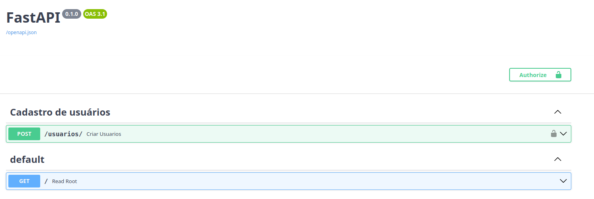
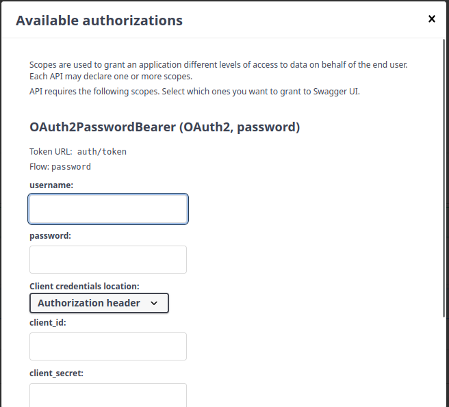
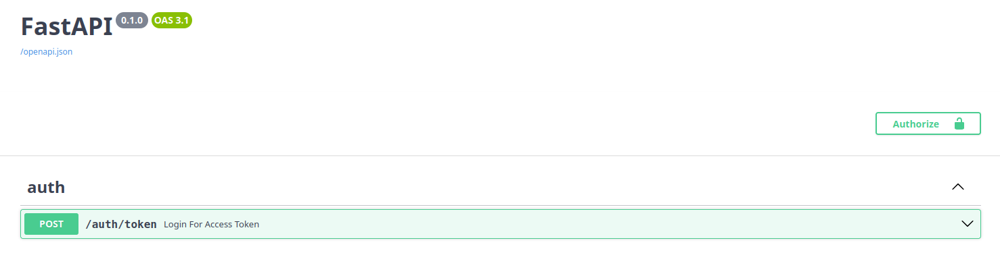

# :lucide-key-round: Auth (Acesso)


A API usa **OAuth2 com fluxo _password_** e **JWT** (JSON Web Token).
O usuário faz login com **email** e **senha**, recebe um token e envia esse token
no cabeçalho `Authorization` das rotas protegidas.

---

## Visão geral do fluxo

```
┌──────────┐   POST /auth/token        ┌────────────┐
│ Cliente  │ ─────────────────────────▶│  API       │
│          │  username=email&password  │            │
│          │                           │ 1. busca usuário pelo email
│          │                           │ 2. verify_password()
│          │◀───────────────────────── │ 3. create_access_token()
│          │  {access_token, bearer}   └────────────┘
│          │
│          │   GET /rota-protegida     ┌────────────┐
│          │ ─────────────────────────▶│  API       │
│          │  Authorization: Bearer XX │ get_current_user()
│          │                           │  - decodifica o JWT
│          │◀───────────────────────── │  - busca usuário pelo "sub"
└──────────┘        resposta           └────────────┘
```

---


## Arquivos envolvidos

| Arquivo | Responsabilidade |
|---|---|
| `src/comprix/security.py` | Funções de segurança: hash de senha, criação e validação do token |
| `src/comprix/auth.py` | Rota HTTP `POST /auth/token` (login) |
| `src/comprix/app.py` | Registra o router com `app.include_router(auth.router)` |

> **Importante:** `security.py` só contém **funções**. Quem expõe o login via HTTP é
> o router em `auth.py`. O `OAuth2PasswordBearer(tokenUrl='auth/token')` apenas
> informa ao Swagger para onde enviar o login — ele **não cria** a rota.

---

## `security.py`

### `get_password_hash(senha)`
Gera o hash da senha com `pwdlib` (`PasswordHash.recommended()`, Argon2).
Use ao cadastrar ou alterar a senha de um usuário. A senha nunca é salva em texto puro.

### `verify_password(senha, hashed_password)`
Compara a senha digitada com o hash salvo no banco. Retorna `True` ou `False`.

### `create_access_token(data)`
Cria o JWT a partir de um dicionário. Claims adicionadas:

| Claim | Conteúdo |
|---|---|
| `sub` | Email do usuário (identificador) |
| `exp` | Data de expiração: agora (UTC) + `ACCESS_TOKEN_EXPIRE_MINUTES` |
| `is_admin` | `True` apenas quando `sub == ADMIN_EMAIL` |

O token é assinado com `SECRET_KEY` usando o algoritmo `ALGORITHM` (definidos em `Settings`).

### `get_current_user(session, token)`
Dependência usada nas rotas protegidas:

1. Lê o token do cabeçalho `Authorization: Bearer <token>` (via `oauth2_scheme`).
2. Decodifica e valida a assinatura e a expiração.
3. Busca o usuário pelo email do `sub`.
4. Em qualquer falha (token inválido, expirado, sem `sub` ou usuário inexistente)
   retorna **401 — "Credencial inválida"**.

Exemplo de uso em uma rota:


```python
from comprix.security import get_current_user

CurrentUser = Annotated[Usuarios, Depends(get_current_user)]


@router.get('/me')
async def me(usuario: CurrentUser):
    return usuario
```

---

## `auth.py` — rota de login

### `POST /auth/token`

Perceba na imagem abaixo, que agora na nossa documentação do Swagger, temos um botão **Autorize**.

{ width="800" }

Recebe os dados como **form-data** (`application/x-www-form-urlencoded`),
como exige a especificação OAuth2.

{ width="800" }


| Campo | Conteúdo |
|---|---|
| `username` | **Email** do usuário |
| `password` | Senha |

> O nome do campo é `username` por exigência do OAuth2, mas no Comprix ele
> sempre recebe o **email**. No código: `form_data.username` → email.

**Respostas**

| Status | Quando | Corpo |
|---|---|---|
| `200` | Email e senha corretos | `{"access_token": "...", "token_type": "bearer"}` |
| `401` | Email inexistente ou senha errada | `{"detail": "Email ou senhas incorretos"}` |
| `422` | Campos ausentes | Erro de validação do FastAPI |

A mesma mensagem é usada para email inexistente e senha errada, para não revelar
quais emails estão cadastrados.

**Exemplo com curl**

```bash
curl -X POST http://127.0.0.1:8000/auth/token \
  -H "Content-Type: application/x-www-form-urlencoded" \
  -d "username=usuario@email.com&password=minhasenha"
```

Usando o token:

```bash
curl http://127.0.0.1:8000/rota-protegida \
  -H "Authorization: Bearer <access_token>"
```

---


## Nossa primeira Rota

Sabemos agora como é todo o procedimento de seguração da nossa aplicação, vamos
para o nosso código.


```
src/comprix/
├── routers/
│   ├── __init__.py
│   └── auth.py      ← novo arquivo
├── app.py
├── database.py
├── models.py
├── security.py
└── settings.py
```

!!! tip "Dica"
    Se o diretório `routers` ainda não existir, crie também um arquivo
    `__init__.py` vazio dentro dele, para que o Python o reconheça como pacote.

### O código

```python title="src/comprix/routers/auth.py"
from http import HTTPStatus
from typing import Annotated

from fastapi import APIRouter, Depends, HTTPException
from fastapi.security import OAuth2PasswordRequestForm
from sqlalchemy import select
from sqlalchemy.ext.asyncio import AsyncSession

from comprix.database import get_session
from comprix.models import Usuarios
from comprix.security import create_access_token, verify_password

router = APIRouter(prefix='/auth', tags=['auth'])
Session = Annotated[AsyncSession, Depends(get_session)]
OAuth2Form = Annotated[OAuth2PasswordRequestForm, Depends()]


@router.post('/token')
async def login_for_access_token(form_data: OAuth2Form, session: Session):
    # form_data.username contém o email digitado
    usuario = await session.scalar(
        select(Usuarios).where(Usuarios.email == form_data.username)
    )

    if not usuario or not verify_password(form_data.password, usuario.senha):
        raise HTTPException(
            status_code=HTTPStatus.UNAUTHORIZED,
            detail='Email ou senhas incorretos',
        )

    access_token = create_access_token(data={'sub': usuario.email})

    return {'access_token': access_token, 'token_type': 'bearer'}
```

### Entendendo o código

#### 1. Criando o router

```python
router = APIRouter(prefix='/auth', tags=['auth'])
```

O `APIRouter` agrupa rotas relacionadas.

- `prefix='/auth'`: todas as rotas deste arquivo começam com `/auth`.
  Assim, `@router.post('/token')` vira **`POST /auth/token`**.
- `tags=['auth']`: agrupa as rotas na seção **auth** do Swagger.

#### 2. Atalhos com `Annotated`

```python
Session = Annotated[AsyncSession, Depends(get_session)]
OAuth2Form = Annotated[OAuth2PasswordRequestForm, Depends()]
```

Em vez de repetir `Depends(...)` em cada rota, criamos tipos que já carregam a
dependência:

- `Session`: injeta a sessão assíncrona do banco de dados.
- `OAuth2Form`: lê os campos `username` e `password` do corpo da requisição
  em formato **form-data**, como exige o OAuth2.

!!! warning "Atenção"
    Se você misturar `form_data = Depends()` com `session: Session`, o Python
    acusa o erro *"Parameter without a default cannot follow a parameter with a
    default"*. Usar `Annotated` nos dois parâmetros resolve isso.

#### 3. Definindo a rota

```python
@router.post('/token')
async def login_for_access_token(form_data: OAuth2Form, session: Session):
```

A função recebe o formulário de login e a sessão do banco, ambos injetados
automaticamente pelo FastAPI.

#### 4. Buscando o usuário

```python
usuario = await session.scalar(
    select(Usuarios).where(Usuarios.email == form_data.username)
)
```

Procura no banco um usuário com o email informado. O campo se chama `username`
por exigência do OAuth2, mas no Comprix ele **contém o email**.

O `session.scalar()` retorna o usuário encontrado ou `None`.

#### 5. Validando email e senha

```python
if not usuario or not verify_password(form_data.password, usuario.senha):
    raise HTTPException(
        status_code=HTTPStatus.UNAUTHORIZED,
        detail='Email ou senhas incorretos',
    )
```

O login é recusado com **401** se:

- o usuário **não existir**; ou
- a senha **não corresponder** ao hash salvo no banco.

A ordem importa: `not usuario` vem primeiro. Se o usuário não existir, o Python
nem chega a avaliar `usuario.senha`, o que evita um `AttributeError`.

!!! info "Por que a mesma mensagem nos dois casos?"
    Se a API respondesse "email não encontrado" ou "senha incorreta", alguém
    poderia descobrir quais emails estão cadastrados apenas tentando logar.
    Uma mensagem genérica evita isso.

#### 6. Gerando o token

```python
access_token = create_access_token(data={'sub': usuario.email})

return {'access_token': access_token, 'token_type': 'bearer'}
```

Cria o JWT com o email do usuário na claim `sub` e devolve no formato que o
OAuth2 (e o botão **Authorize** do Swagger) esperam.

### Registrando o router

Sem esta etapa a rota não existe, e qualquer chamada retorna **404**.
No `app.py`, inclua o router:

```python title="src/comprix/app.py"
from comprix.routers import auth

app.include_router(auth.router)
```

Para conferir, acesse `/docs` e verifique se a rota `POST /auth/token` aparece
na seção **auth**.

{ width="800" }

---

## Testes

Crie o arquivo `test_auth.py` dentro do diretório `tests`:

```
tests/
├── conftest.py
└── test_auth.py      ← novo arquivo
```

### O código

```python title="tests/test_auth.py"
from http import HTTPStatus

from jwt import decode

from comprix.settings import Settings

settings = Settings()


def test_login_sucesso(client, usuario):
    """Teste de autenticação, passando os parametros da rota"""
    response = client.post(
        '/auth/token',
        data={'username': usuario.email, 'password': usuario.clean_password},
    )

    # Retorna o código 200 - sucesso
    assert response.status_code == HTTPStatus.OK
    # verifica se dentro do json do token tem o 'bearer'
    assert response.json()['token_type'] == 'bearer'
    # verifica se dentro do json tem o token
    assert response.json()['access_token']


def test_token_comtem_email_e_expiracao(client, usuario):
    """Teste que verifica se dentro do token existe as CLAINS sub e exp"""
    # Faz a requisição de autenticação passando os parametros
    response = client.post(
        '/auth/token',
        data={'username': usuario.email, 'password': usuario.clean_password},
    )

    # Guarda o token em um objeto
    token = response.json()['access_token']

    # Utiliza o decode para comparar
    payload = decode(
        token, settings.SECRET_KEY, algorithms=[settings.ALGORITHM]
    )

    # verifica se dentro do token o sub e igual o email
    assert payload['sub'] == usuario.email
    # verifica se dentro do token tem o 'exp' de expiração
    assert 'exp' in payload


def test_login_senha_incorreta(client, usuario):
    """Teste que verifica quando o usuário digita a senha inválida"""
    # Faz a requisição de autenticação passando os parametros
    response = client.post(
        '/auth/token',
        data={'username': usuario.email, 'password': 'senha_errada'},
    )

    # verifica se o status code É 401 NÃO AUTORIZADO
    assert response.status_code == HTTPStatus.UNAUTHORIZED

    # verifica se a mensagem está correta no json
    assert response.json()['detail'] == 'Email ou senhas incorretos'


def test_login_email_incorreto(client, usuario):
    """Teste que verifica quando o email digito está inválido"""
    # Faz a requisição de autenticação passando os parametros
    response = client.post(
        '/auth/token',
        data={
            'username': 'incorreto@email.com',
            'password': usuario.clean_password,
        },
    )

    # verifica se o status code É 401 NÃO AUTORIZADO
    assert response.status_code == HTTPStatus.UNAUTHORIZED

    # verifica se a mensagem está correta no json
    assert response.json()['detail'] == 'Email ou senhas incorretos'


def test_login_sem_campos_digitados(client):
    """Teste quando solicita a autenticação e não digita os email e senha"""
    # Faz a requisição de autenticação passando os parametros
    response = client.post('/auth/token', data={})

    # verifica se o status code É 422 UNPROCESSABLE_ENTITY
    assert response.status_code == HTTPStatus.UNPROCESSABLE_ENTITY
```

### A fixture `usuario`

Os testes usam a fixture `usuario`, definida no `conftest.py`. Ela cria um
usuário no banco de testes antes de cada teste que a solicita.

```python title="tests/conftest.py"
@pytest_asyncio.fixture
async def usuario(session):
    senha = 'testing_senha'

    usuario = Usuarios(
        nome='Usuário Teste',
        email='teste@comprix.com',
        senha=get_password_hash(senha),  # o banco guarda o hash
    )
    session.add(usuario)
    await session.commit()
    await session.refresh(usuario)

    usuario.clean_password = senha  # senha original, só para os testes

    return usuario
```

1. A senha é salva **com hash**, como o cadastro real faria.
2. `add` + `commit` gravam o usuário no banco.
3. `refresh` recarrega o objeto com os dados gerados pelo banco (como o `id`).
4. `clean_password` guarda a senha original em memória. Não é uma coluna do
   model e **não vai para o banco**.

!!! warning "Senha em texto puro nos testes"
    O banco guarda apenas o **hash** da senha. No login do teste, use
    `usuario.clean_password` (a senha original) e não `usuario.senha` (o hash).
    Enviar o hash faz o `verify_password` falhar e a rota retorna `401`.

### Entendendo os testes

#### Configuração inicial

```python
from jwt import decode

from comprix.settings import Settings

settings = Settings()
```

- `decode`: usado para abrir o token e conferir as claims.
- `settings`: fornece a `SECRET_KEY` e o `ALGORITHM`, os mesmos usados pela
  aplicação para assinar o token.

#### `test_login_sucesso`

```python
response = client.post(
    '/auth/token',
    data={'username': usuario.email, 'password': usuario.clean_password},
)
```

Faz o login com email e senha corretos.

Repare que usamos `data=` e não `json=`: a rota espera os dados em
**form-data**, como exige o OAuth2. Com `json=`, a resposta seria `422`.

Verificações:

| Assert | O que garante |
|---|---|
| `status_code == HTTPStatus.OK` | O login foi aceito (`200`) |
| `token_type == 'bearer'` | O tipo do token está no formato OAuth2 |
| `access_token` | O token foi gerado e não está vazio |

#### `test_token_comtem_email_e_expiracao`

```python
token = response.json()['access_token']

payload = decode(token, settings.SECRET_KEY, algorithms=[settings.ALGORITHM])
```

Faz o login, pega o token da resposta e o **decodifica**. O `payload` é um
dicionário com as claims do token.

| Assert | O que garante |
|---|---|
| `payload['sub'] == usuario.email` | O token identifica o usuário correto |
| `'exp' in payload` | O token tem data de expiração |

Esse teste também prova que o token foi assinado com a `SECRET_KEY` correta:
se não fosse, o `decode` lançaria um erro e o teste falharia.

#### `test_login_senha_incorreta`

```python
data = {'username': usuario.email, 'password': 'senha_errada'}
```

O usuário existe, mas a senha está errada. O `verify_password` retorna `False`
e a rota responde:

| Assert | O que garante |
|---|---|
| `status_code == HTTPStatus.UNAUTHORIZED` | O login foi recusado (`401`) |
| `detail == 'Email ou senhas incorretos'` | A mensagem genérica foi retornada |

#### `test_login_email_incorreto`

```python
data = {
    'username': 'incorreto@email.com',
    'password': usuario.clean_password,
}
```

Aqui a senha é **válida**, mas o email não existe no banco. O `session.scalar()`
retorna `None` e a rota recusa o login.

O resultado esperado é **idêntico** ao do teste anterior: mesmo status `401` e
mesma mensagem. Isso confirma que a API **não revela** se o problema foi o email
ou a senha.

!!! info "Por que usar a senha correta aqui?"
    Usando a senha válida de um usuário existente, garantimos que o `401`
    acontece **apenas** por causa do email, isolando o cenário testado.

#### `test_login_sem_campos_digitados`

```python
response = client.post('/auth/token', data={})
```

Envia o formulário vazio. O `OAuth2PasswordRequestForm` exige `username` e
`password`, então a validação falha **antes** de a rota ser executada, e o
FastAPI responde automaticamente com `422`.

Esse teste não precisa da fixture `usuario`, porque nem chega a consultar o
banco.

### Resumo

| Teste | Cenário | Esperado |
|---|---|---|
| `test_login_sucesso` | Email e senha corretos | `200` + token |
| `test_token_comtem_email_e_expiracao` | Conteúdo do token | `sub` e `exp` |
| `test_login_senha_incorreta` | Senha errada | `401` |
| `test_login_email_incorreto` | Email não cadastrado | `401` |
| `test_login_sem_campos_digitados` | Formulário vazio | `422` |

### Executando os testes

Todos os testes de autenticação:

```bash
poetry run pytest tests/test_auth.py -v
```

Apenas um teste:

```bash
poetry run pytest tests/test_auth.py::test_login_sucesso -v
```

Saída esperada:

```
tests/test_auth.py::test_login_sucesso PASSED
tests/test_auth.py::test_token_comtem_email_e_expiracao PASSED
tests/test_auth.py::test_login_senha_incorreta PASSED
tests/test_auth.py::test_login_email_incorreto PASSED
tests/test_auth.py::test_login_sem_campos_digitados PASSED
```

---

## Conclusão

Com isso, temos a **primeira rota** da aplicação funcionando e testada. 🎉

### O que construímos

- **`security.py`**: as ferramentas de segurança (hash de senha, criação e
  validação do token JWT).
- **`routers/auth.py`**: a rota `POST /auth/token`, que recebe email e senha e
  devolve um token de acesso.
- **`app.py`**: o registro do router, que torna a rota disponível na API.
- **`tests/test_auth.py`**: os testes que garantem que o login funciona e que
  os cenários de erro são tratados corretamente.

### O que aprendemos

| Conceito | Na prática |
|---|---|
| **OAuth2 password flow** | O cliente troca email e senha por um token |
| **JWT** | O token carrega o email (`sub`) e a validade (`exp`), assinado com a `SECRET_KEY` |
| **Hash de senha** | O banco nunca guarda a senha real, apenas o hash gerado com Argon2 |
| **`APIRouter`** | Organiza as rotas por assunto, com prefixo e tag no Swagger |
| **`Annotated` + `Depends`** | Injeta a sessão do banco e o formulário de login de forma limpa |
| **Mensagem genérica de erro** | A API não revela se o email está cadastrado |
| **Fixtures** | Preparam o banco de testes com um usuário antes de cada teste |

### O fluxo completo

1. O usuário envia **email** e **senha** para `POST /auth/token`.
2. A API busca o usuário pelo email e confere a senha com `verify_password`.
3. Se estiver tudo certo, a API gera o token com `create_access_token`.
4. O cliente usa esse token no cabeçalho `Authorization: Bearer <token>` para
   acessar as rotas protegidas.

!!! success "Rota pronta"
    A partir de agora, o botão **Authorize** do Swagger funciona: basta informar
    email e senha para testar as rotas protegidas direto pela documentação.

### Próximos passos

- [ ] Proteger as rotas da aplicação usando `get_current_user` como dependência.
- [ ] Criar a rota `POST /auth/refresh` para renovar o token (já declarada no
      `refreshUrl` do `oauth2_scheme`).
- [ ] Testar rotas protegidas com token válido, inválido e expirado.
- [ ] Usar a claim `is_admin` para restringir rotas administrativas.