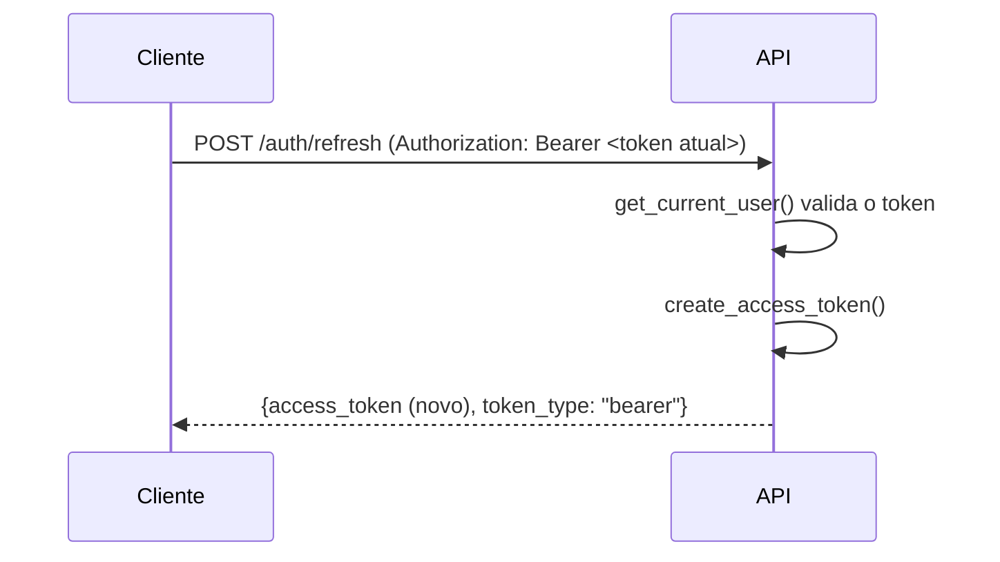
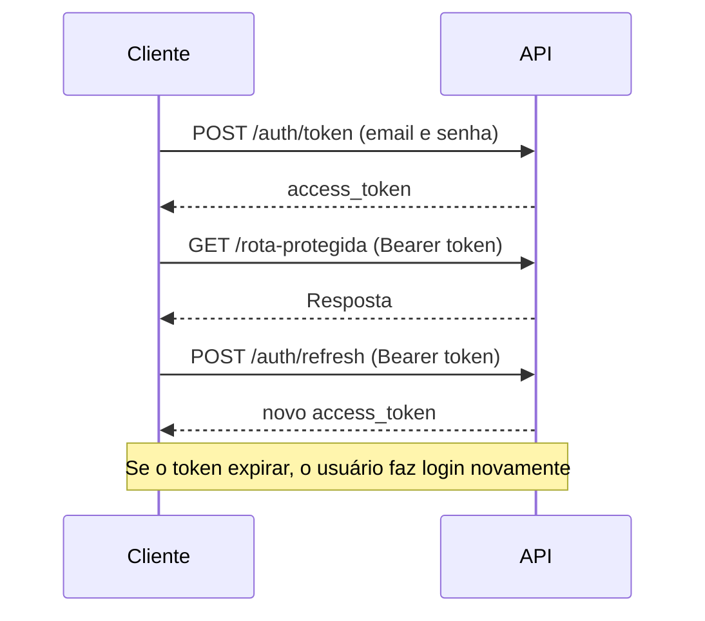

# :lucide-refresh-cw: Refresh (Token)

## Rota de Refresh

O token gerado no login expira depois de `ACCESS_TOKEN_EXPIRE_MINUTES`. Para o
usuário não precisar digitar email e senha de novo a todo momento, criamos a
rota `POST /auth/refresh`, que troca um token **ainda válido** por um token
novo, com a validade renovada.



!!! info "Expiração deslizante"
    O token só pode ser renovado **enquanto ainda é válido**. Se o usuário ficar
    parado além do tempo de expiração, ele precisa fazer login novamente.

### O código

A rota fica no mesmo arquivo do login. As novidades são o import do
`get_current_user`, o tipo `CurrentUser` e a função `refresh_access_token`:

```python title="src/comprix/routers/auth.py" hl_lines="11-15 20 41-45"
from http import HTTPStatus
from typing import Annotated

from fastapi import APIRouter, Depends, HTTPException
from fastapi.security import OAuth2PasswordRequestForm
from sqlalchemy import select
from sqlalchemy.ext.asyncio import AsyncSession

from comprix.database import get_session
from comprix.models import Usuarios
from comprix.security import (
    create_access_token,
    get_current_user,
    verify_password,
)

router = APIRouter(prefix='/auth', tags=['auth'])
Session = Annotated[AsyncSession, Depends(get_session)]
OAuth2Form = Annotated[OAuth2PasswordRequestForm, Depends()]
CurrentUser = Annotated[Usuarios, Depends(get_current_user)]


@router.post('/token')
async def login_for_access_token(form_data: OAuth2Form, session: Session):
    # form_data.username contém o email digitado
    usuario = await session.scalar(
        select(Usuarios).where(Usuarios.email == form_data.username)
    )

    if not usuario or not verify_password(form_data.password, usuario.senha):
        raise HTTPException(
            status_code=HTTPStatus.UNAUTHORIZED,
            detail='Email ou senhas incorretos',
        )

    access_token = create_access_token(data={'sub': usuario.email})

    return {'access_token': access_token, 'token_type': 'bearer'}


@router.post('/refresh')
async def refresh_access_token(usuario: CurrentUser):
    new_access_token = create_access_token(data={'sub': usuario.email})

    return {'access_token': new_access_token, 'token_type': 'bearer'}
```

### Entendendo o código

#### 1. O tipo `CurrentUser`

```python
CurrentUser = Annotated[Usuarios, Depends(get_current_user)]
```

Assim como o `Session`, é um atalho com `Annotated`. Toda rota que receber um
parâmetro do tipo `CurrentUser` passa a **exigir um token válido**.

O `get_current_user` (do `security.py`) faz todo o trabalho:

1. Lê o token do cabeçalho `Authorization: Bearer <token>`.
2. Valida a assinatura e a expiração.
3. Busca o usuário pelo email do `sub`.
4. Em qualquer falha, retorna **401** antes de a rota ser executada.

#### 2. A rota

```python
@router.post('/refresh')
async def refresh_access_token(usuario: CurrentUser):
    new_access_token = create_access_token(data={'sub': usuario.email})

    return {'access_token': new_access_token, 'token_type': 'bearer'}
```

Como a validação já aconteceu no `get_current_user`, a rota só precisa gerar um
token novo para o usuário recebido. O formato da resposta é o mesmo do login.

!!! tip "Esse é o padrão das rotas protegidas"
    Para proteger qualquer rota da aplicação, basta adicionar um parâmetro do
    tipo `CurrentUser`. A rota de refresh é o primeiro exemplo disso.

**Respostas**

| Status | Quando | Corpo |
|---|---|---|
| `200` | Token válido | `{"access_token": "...", "token_type": "bearer"}` |
| `401` | Sem token, token inválido ou expirado | `{"detail": "Credencial inválida"}` ou `{"detail": "Not authenticated"}` |

**Exemplo com curl**

```bash
curl -X POST http://127.0.0.1:8000/auth/refresh \
  -H "Authorization: Bearer <access_token>"
```

### Testes

#### Instalando o freezegun

Para testar um token expirado, precisamos "viajar no tempo". A biblioteca
`freezegun` congela o relógio do Python em uma data escolhida:

```bash
poetry add --group dev freezegun
```

#### Fixture `token`

Vários testes precisam de um token válido. Em vez de repetir o login em cada
um, criamos uma fixture no `conftest.py`:

```python title="tests/conftest.py"
@pytest.fixture
def token(client, usuario):
    response = client.post(
        '/auth/token',
        data={'username': usuario.email, 'password': usuario.clean_password},
    )
    return response.json()['access_token']
```

Ela faz o login com o usuário da fixture `usuario` e devolve só o token.

#### O código

Adicione os novos imports no topo do `test_auth.py`:

```python title="tests/test_auth.py"
from datetime import datetime, timedelta
from http import HTTPStatus

from freezegun import freeze_time
from jwt import decode

from comprix.settings import Settings

settings = Settings()
```

E os testes do refresh no final do arquivo:

```python title="tests/test_auth.py"
def test_refresh_token_sucesso(client, usuario, token):
    """Teste que renova o token com um token válido"""
    response = client.post(
        '/auth/refresh',
        headers={'Authorization': f'Bearer {token}'},
    )

    assert response.status_code == HTTPStatus.OK
    assert response.json()['token_type'] == 'bearer'

    payload = decode(
        response.json()['access_token'],
        settings.SECRET_KEY,
        algorithms=[settings.ALGORITHM],
    )

    assert payload['sub'] == usuario.email


def test_refresh_token_sem_token_anterior(client):
    """Teste que tenta renovar sem enviar o token anterior"""
    response = client.post('/auth/refresh')

    assert response.status_code == HTTPStatus.UNAUTHORIZED


def test_refresh_token_invalido(client):
    """Teste que tenta renovar com um token falso"""
    response = client.post(
        '/auth/refresh',
        headers={'Authorization': 'Bearer token-invalido'},
    )

    assert response.status_code == HTTPStatus.UNAUTHORIZED
    assert response.json()['detail'] == 'Credencial inválida'


def test_refresh_token_expirado(client, usuario):
    """Teste que tenta renovar com um token já expirado"""
    agora = datetime(2026, 1, 1, 12, 0, 0)

    with freeze_time(agora):
        response = client.post(
            '/auth/token',
            data={
                'username': usuario.email,
                'password': usuario.clean_password,
            },
        )
        token = response.json()['access_token']

    depois = agora + timedelta(
        minutes=settings.ACCESS_TOKEN_EXPIRE_MINUTES + 1
    )

    with freeze_time(depois):
        response = client.post(
            '/auth/refresh',
            headers={'Authorization': f'Bearer {token}'},
        )

    assert response.status_code == HTTPStatus.UNAUTHORIZED
    assert response.json()['detail'] == 'Credencial inválida'
```

### Entendendo os testes

#### `test_refresh_token_sucesso`

```python
response = client.post(
    '/auth/refresh',
    headers={'Authorization': f'Bearer {token}'},
)
```

Envia o token da fixture no cabeçalho `Authorization`, no formato
`Bearer <token>`. Depois decodifica o token novo e confere se ele pertence ao
mesmo usuário (`sub`).

| Assert | O que garante |
|---|---|
| `status_code == HTTPStatus.OK` | A renovação foi aceita (`200`) |
| `token_type == 'bearer'` | O formato da resposta segue o OAuth2 |
| `payload['sub'] == usuario.email` | O token novo é do mesmo usuário |

!!! note "Por que não comparamos o token novo com o antigo?"
    Se o refresh acontecer no mesmo segundo do login, o `exp` é igual e o token
    gerado é **idêntico**. Comparar os dois deixaria o teste instável.

#### `test_refresh_token_sem_token_anterior`

```python
response = client.post('/auth/refresh')
```

Chama a rota sem o cabeçalho `Authorization`. O próprio `oauth2_scheme` recusa
a requisição com **401**, antes mesmo de o `get_current_user` decodificar algo.

Por isso, aqui não verificamos a mensagem: ela vem do FastAPI
(`Not authenticated`), não da nossa aplicação.

#### `test_refresh_token_invalido`

```python
headers={'Authorization': 'Bearer token-invalido'}
```

Envia um texto qualquer no lugar do token. O `decode` lança `DecodeError`, e o
`get_current_user` responde **401** com a nossa mensagem `Credencial inválida`.

#### `test_refresh_token_expirado`

Esse teste usa o `freeze_time` duas vezes:

```python
agora = datetime(2026, 1, 1, 12, 0, 0)

with freeze_time(agora):
    # login: o token é gerado com exp = 12:00 + EXPIRE_MINUTES
```

**Passo 1:** congela o relógio em `12:00` e faz o login. O token nasce com a
expiração calculada a partir desse horário.

```python
depois = agora + timedelta(
    minutes=settings.ACCESS_TOKEN_EXPIRE_MINUTES + 1
)

with freeze_time(depois):
    # refresh: o relógio está 1 minuto após a expiração
```

**Passo 2:** avança o relógio para **1 minuto depois** da expiração e tenta
renovar. O `decode` lança `ExpiredSignatureError`, e a rota responde **401**.

!!! tip "Por que usar `ACCESS_TOKEN_EXPIRE_MINUTES + 1`?"
    Calcular o tempo a partir da configuração deixa o teste correto mesmo que o
    tempo de expiração mude no `.env`. Um valor fixo, como `31` minutos,
    quebraria o teste se a expiração passasse para 60.

### Resumo

| Teste | Cenário | Esperado |
|---|---|---|
| `test_refresh_token_sucesso` | Token válido | `200` + token novo do mesmo usuário |
| `test_refresh_token_sem_token_anterior` | Sem cabeçalho `Authorization` | `401` |
| `test_refresh_token_invalido` | Token falso | `401` + `Credencial inválida` |
| `test_refresh_token_expirado` | Token vencido | `401` + `Credencial inválida` |

Saída esperada, com os testes do login e do refresh:

```
tests/test_auth.py::test_login_sucesso PASSED                            [ 11%]
tests/test_auth.py::test_token_comtem_email_e_expiracao PASSED           [ 22%]
tests/test_auth.py::test_login_senha_incorreta PASSED                    [ 33%]
tests/test_auth.py::test_login_email_incorreto PASSED                    [ 44%]
tests/test_auth.py::test_login_sem_campos_digitados PASSED               [ 55%]
tests/test_auth.py::test_refresh_token_sucesso PASSED                    [ 66%]
tests/test_auth.py::test_refresh_token_sem_token_anterior PASSED         [ 77%]
tests/test_auth.py::test_refresh_token_invalido PASSED                   [ 88%]
tests/test_auth.py::test_refresh_token_expirado PASSED                   [100%]

============================== 9 passed ==============================
```

Para rodar apenas os testes do refresh:

```bash
poetry run pytest tests/test_auth.py -k refresh -v
```

O `-k refresh` executa somente os testes que têm `refresh` no nome.

---

## Conclusão

Com a rota de refresh, o ciclo de autenticação do Comprix está completo:
o usuário faz login uma vez e pode renovar o token enquanto estiver usando a
aplicação, sem precisar digitar a senha novamente. 🎉

### O que construímos

- **`POST /auth/refresh`**: troca um token ainda válido por um token novo, com
  a validade renovada.
- **`CurrentUser`**: o atalho que protege qualquer rota exigindo um token
  válido.
- **Fixture `token`**: entrega um token pronto para os testes de rotas
  protegidas.
- **Testes com `freezegun`**: simulam a passagem do tempo para validar o
  comportamento com token expirado.

### O que aprendemos

| Conceito | Na prática |
|---|---|
| **Rota protegida** | Basta um parâmetro do tipo `CurrentUser` para exigir token |
| **Expiração deslizante** | O token só é renovado enquanto ainda está válido |
| **Cabeçalho `Authorization`** | O token é enviado como `Bearer <token>` |
| **`freezegun`** | Congela e avança o relógio para testar expiração |
| **Testes resilientes** | Usar `ACCESS_TOKEN_EXPIRE_MINUTES + 1` em vez de valores fixos |

### O fluxo completo de autenticação



!!! success "Autenticação pronta"
    Login, renovação de token e validação de rotas protegidas estão
    funcionando e cobertos por testes. A partir daqui, toda nova rota que
    precisar de autenticação usa o mesmo padrão: um parâmetro `CurrentUser`.

### Próximos passos

- [ ] Proteger as rotas da aplicação usando `CurrentUser`.
- [ ] Usar a claim `is_admin` para restringir rotas administrativas.
- [ ] Avaliar o modelo com dois tokens (*access* curto + *refresh* longo), caso
      a aplicação precise de sessões mais longas com mais segurança.