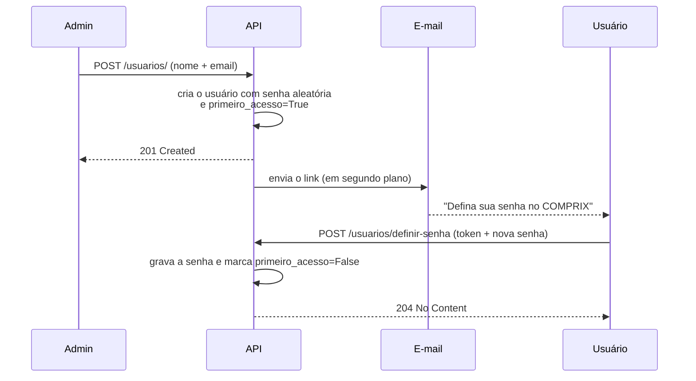

# :lucide-users: Usuários

Com a autenticação pronta, já sabemos **quem** está fazendo cada requisição.
Agora vamos criar o **cadastro de usuários**.

No COMPRIX, apenas **administradores** podem cadastrar usuários. O
administrador informa só o **nome** e o **e-mail**. A senha é definida pelo
**próprio usuário**, por um link enviado por e-mail.

Nesta página veremos:

- a função `criar_admin`, que garante que sempre exista um administrador;
- a rota `POST /usuarios/`, que cadastra o usuário e envia o e-mail;
- o envio de e-mail com template HTML;
- a rota `POST /usuarios/definir-senha`, usada pelo link do e-mail;
- os testes de tudo isso.

!!! note "Em breve"
    As rotas de **alterar** (`PUT` e `PATCH`) e **excluir** (`DELETE`) serão
    adicionadas nesta mesma página.

---

## 1. Visão geral do fluxo



| Etapa | O que acontece |
|---|---|
| Cadastro | O admin informa nome e e-mail. A API cria o usuário com uma **senha aleatória** que ninguém conhece. |
| E-mail | A API gera um token de uso único, válido por 24 horas, e envia o link por e-mail. |
| Definir senha | O usuário abre o link, escolhe a senha, e a partir daí consegue fazer login. |

!!! info "Por que não enviar a senha por e-mail?"
    E-mail não é um canal seguro: a mensagem fica guardada na caixa de
    entrada e pode ser encaminhada. Com o link, a senha **nunca** passa pelo
    e-mail, e só o próprio usuário a conhece.

---

## 2. Arquivos envolvidos

```text
src/comprix/
├── routers/
│   ├── auth.py
│   └── usuarios.py            ← rotas de usuários
├── schemas/
│   ├── __init__.py            ← exporta os schemas
│   └── usuarios.py            ← UsuarioSchema, DefinirSenhaSchema...
├── templates/
│   └── email/
│       └── definir_senha.html ← template do e-mail
├── database.py                ← lifespan chama o criar_admin
├── email.py                   ← envio de e-mail
├── security.py                ← token do link de definir senha
└── settings.py                ← configurações do e-mail
```

---

## 3. Configurações

### 3.1 O `.env`

```env
# Administrador criado automaticamente
ADMIN_USER="Administrador"
ADMIN_EMAIL="admin@seudominio.com.br"
ADMIN_SENHA="senha_do_admin"

# Servidor de e-mail
MAIL_USERNAME="contato@seudominio.com.br"
MAIL_PASSWORD="senha_da_caixa_de_email"
MAIL_FROM="contato@seudominio.com.br"
MAIL_SERVER="smtp.hostinger.com"
MAIL_PORT=587

# Endereço da página onde o usuário define a senha
FRONTEND_URL="http://localhost:5173"
```

| Variável | Para que serve |
|---|---|
| `MAIL_USERNAME` | Usuário do servidor de e-mail (o endereço completo). |
| `MAIL_PASSWORD` | Senha da caixa de e-mail. |
| `MAIL_FROM` | Remetente. Precisa ser **igual** ao `MAIL_USERNAME`. |
| `MAIL_SERVER` | Servidor SMTP. Na Hostinger: `smtp.hostinger.com`. |
| `MAIL_PORT` | `587` usa STARTTLS; `465` usa SSL/TLS direto. O `email.py` escolhe o modo pela porta. |
| `FRONTEND_URL` | Endereço do frontend, **sem barra no final**. É usado para montar o link do e-mail. |

!!! warning "O remetente precisa ser o dono da conta"
    Se o `MAIL_FROM` for diferente do `MAIL_USERNAME`, o servidor recusa o
    envio com `553 Sender address rejected: not owned by user`. Até uma letra
    a mais causa esse erro.

!!! danger "Hotmail e Outlook.com não funcionam"
    A Microsoft desativou o login por usuário e senha no SMTP das contas
    pessoais. O servidor responde `535 Authentication unsuccessful`. Use um
    e-mail do seu domínio (como o da Hostinger), o Gmail com **senha de app**
    ou um serviço transacional (Brevo, Resend, SendGrid, Amazon SES).

### 3.2 O `settings.py`

```python title="src/comprix/settings.py"
from pydantic import SecretStr
from pydantic_settings import BaseSettings, SettingsConfigDict


class Settings(BaseSettings):
    model_config = SettingsConfigDict(
        env_file='.env', env_file_encoding='utf-8'
    )

    # ... demais campos (DATABASE_URL, SECRET_KEY, ADMIN_*, etc.)
    MAIL_USERNAME: str
    MAIL_PASSWORD: SecretStr
    MAIL_FROM: str
    MAIL_SERVER: str
    MAIL_PORT: int
    FRONTEND_URL: str
```

O `SecretStr` esconde o valor da senha. Em tracebacks e logs, ela aparece como
`'**********'`, e não em texto puro. Para ler o valor real, use
`settings.MAIL_PASSWORD.get_secret_value()`, como faz a função
`testar_conexao` do `email.py`. O `ConnectionConfig` do fastapi-mail aceita o
`SecretStr` diretamente.

!!! danger "Não esqueça o `.env.example`"
    Todas as variáveis novas (`MAIL_*` e `FRONTEND_URL`) também precisam ir
    para o `.env.example`, sem os valores secretos. Como elas não têm valor
    padrão, quem baixar o projeto sem elas no `.env` verá a API parar ao
    iniciar com um `ValidationError` do pydantic-settings.

!!! warning "O `.env` só é lido quando a API sobe"
    Depois de alterar o `.env`, **pare e suba a API de novo**. O `--reload` do
    uvicorn só reinicia quando um arquivo `.py` muda.

---

## 4. Schemas

```python title="src/comprix/schemas/usuarios.py"
from pydantic import BaseModel, ConfigDict, EmailStr, Field


class UsuarioSchema(BaseModel):
    """Dados para criar um usuário."""

    nome: str = Field(max_length=50)
    email: EmailStr = Field(max_length=100)


class UsuarioPublico(BaseModel):
    """Dados devolvidos pela API (sem a senha)."""

    model_config = ConfigDict(from_attributes=True)
    id: int
    nome: str
    email: EmailStr
    status: bool


class DefinirSenhaSchema(BaseModel):
    """Dados para o usuário definir a senha pelo link."""

    token: str
    nova_senha: str = Field(min_length=8)
```

| Schema | Uso |
|---|---|
| `UsuarioSchema` | Corpo do `POST /usuarios/`. Só **nome** e **e-mail**: o admin não define a senha. |
| `UsuarioPublico` | Resposta da API. Não tem o campo `senha`, então o hash nunca sai da API. |
| `DefinirSenhaSchema` | Corpo do `POST /usuarios/definir-senha`. A senha precisa ter pelo menos 8 caracteres. |

O arquivo também já tem dois schemas preparados para as próximas rotas
(listar e alterar usuários):

```python title="src/comprix/schemas/usuarios.py"
class UsuarioUpdateSchema(BaseModel):
    """Dados para atualizar um usuário (todos opcionais)."""

    nome: str | None = Field(None, max_length=50)
    email: EmailStr | None = Field(None, max_length=100)
    senha: str | None = Field(None, min_length=8)
    status: bool | None = None


class UsuarioLista(BaseModel):
    """Lista de usuários devolvida pela API."""

    usuarios: list[UsuarioPublico]
```

| Schema | Uso |
|---|---|
| `UsuarioUpdateSchema` | Corpo das futuras rotas `PUT`/`PATCH`. Todos os campos são opcionais (`None`), para alterar só o que for enviado. |
| `UsuarioLista` | Resposta da futura rota que lista os usuários. |

!!! tip "O `max_length` repete o tamanho da coluna"
    `nome` tem `max_length=50` e `email` tem `max_length=100`, os mesmos
    tamanhos do `String(50)` e `String(100)` do model. Assim, um texto grande
    demais é recusado com **422** pela API, antes de chegar ao banco.

Como `schemas` é uma **pasta**, cada schema novo também precisa ser exportado
no `__init__.py`:

```python title="src/comprix/schemas/__init__.py"
from comprix.schemas.app import Message
from comprix.schemas.usuarios import (
    DefinirSenhaSchema,
    UsuarioLista,
    UsuarioPublico,
    UsuarioSchema,
)

__all__ = [
    'Message',
    'DefinirSenhaSchema',
    'UsuarioLista',
    'UsuarioPublico',
    'UsuarioSchema',
]
```

O `UsuarioUpdateSchema` ainda não é exportado: ele entra no `__init__.py`
junto com as rotas de alteração.

Sem isso, o import `from comprix.schemas import DefinirSenhaSchema` falha com
`ImportError`.

---

## 5. O token do link: ajustes no `security.py`

### 5.1 Criando o token

```python title="src/comprix/security.py"
def create_definir_senha_token(email: str) -> str:
    """Cria o token do link de definir senha, válido por 24 horas."""
    expire = datetime.now(tz=ZoneInfo('UTC')) + timedelta(hours=24)

    return encode(
        {'sub': email, 'tipo': 'definir_senha', 'exp': expire},
        settings.SECRET_KEY,
        algorithm=settings.ALGORITHM,
    )
```

| Claim | Valor | Por quê |
|---|---|---|
| `sub` | e-mail do usuário | Identifica de quem é o link. |
| `tipo` | `'definir_senha'` | Diferencia este token do token de acesso. |
| `exp` | agora + 24 horas | O link expira em um dia. |

### 5.2 Bloqueando o token do link no `get_current_user`

O token do link é assinado com a **mesma** `SECRET_KEY` e tem um `sub` válido.
Sem um cuidado extra, ele funcionaria como token de acesso, e quem recebesse o
e-mail poderia usar a API sem nunca definir a senha.

Por isso o `get_current_user` recusa esse tipo de token:

```python title="src/comprix/security.py" hl_lines="8"
    try:
        payload = decode(
            token, settings.SECRET_KEY, algorithms=[settings.ALGORITHM]
        )
        subject_email = payload.get('sub')

        # O token do link de definir senha não vale como token de acesso
        if not subject_email or payload.get('tipo') == 'definir_senha':
            raise credentials_exception
```

---

## 6. Envio de e-mail: o `email.py`

### 6.1 Instalando

```bash
poetry add fastapi-mail
```

### 6.2 O código

```python title="src/comprix/email.py"
from datetime import datetime
from pathlib import Path
from zoneinfo import ZoneInfo

from fastapi_mail import ConnectionConfig, FastMail, MessageSchema, MessageType
from jwt import decode

from comprix.settings import Settings

settings = Settings()

FUSO_BRASIL = ZoneInfo('America/Sao_Paulo')

PORT_STARTLS = 587
PORT_SSL = 465

conf = ConnectionConfig(
    MAIL_USERNAME=settings.MAIL_USERNAME,
    MAIL_PASSWORD=settings.MAIL_PASSWORD,
    MAIL_FROM=settings.MAIL_FROM,
    MAIL_FROM_NAME='COMPRIX',
    MAIL_SERVER=settings.MAIL_SERVER,
    MAIL_PORT=settings.MAIL_PORT,
    MAIL_STARTTLS=settings.MAIL_PORT == PORT_STARTLS,
    MAIL_SSL_TLS=settings.MAIL_PORT == PORT_SSL,
    USE_CREDENTIALS=bool(settings.MAIL_USERNAME),
    TEMPLATE_FOLDER=Path(__file__).parent / 'templates' / 'email',
)


def data_expiracao(token: str) -> str:
    """Lê a claim 'exp' do token e formata no horário de Brasília."""
    payload = decode(
        token,
        settings.SECRET_KEY,
        algorithms=[settings.ALGORITHM],
        # Só lemos a data; quem valida a expiração é a rota /definir-senha
        options={'verify_exp': False},
    )
    expira = datetime.fromtimestamp(payload['exp'], tz=FUSO_BRASIL)

    return expira.strftime('%d/%m/%Y às %H:%M')


async def enviar_email_definir_senha(
    nome: str, email: str, token: str
) -> None:
    """Envia o e-mail com o link para o usuário definir a senha."""
    mensagem = MessageSchema(
        subject='Defina sua senha no COMPRIX',
        recipients=[email],
        template_body={
            'nome': nome,
            'link': f'{settings.FRONTEND_URL}/definir-senha?token={token}',
            'expira_em': data_expiracao(token),
        },
        subtype=MessageType.html,
    )

    await FastMail(conf).send_message(
        mensagem, template_name='definir_senha.html'
    )
```

### 6.3 Entendendo o código

#### A configuração da conexão

| Parte | O que faz |
|---|---|
| `MAIL_FROM_NAME='COMPRIX'` | O remetente aparece como **COMPRIX** na caixa de entrada. |
| `PORT_STARTLS` e `PORT_SSL` | Constantes com as portas padrão do SMTP. Dar nome aos números evita o aviso **PLR2004** (*magic value*) do ruff. |
| `MAIL_STARTTLS=settings.MAIL_PORT == PORT_STARTLS` | Liga a criptografia STARTTLS na porta 587: a conexão começa sem criptografia e é "promovida" logo em seguida. |
| `MAIL_SSL_TLS=settings.MAIL_PORT == PORT_SSL` | Liga o SSL/TLS direto na porta 465: a conexão já nasce criptografada. Os dois modos nunca ficam ligados ao mesmo tempo. |
| `USE_CREDENTIALS=bool(...)` | Faz login no SMTP só se o `MAIL_USERNAME` estiver preenchido. |
| `TEMPLATE_FOLDER` | Pasta dos templates. O `Path(__file__).parent` aponta para a pasta do `email.py`, independentemente de onde a API for iniciada. |

#### `data_expiracao`

Lê a validade **de dentro do próprio token** e converte para o horário de
Brasília. Assim, a data mostrada no e-mail é sempre a mesma que o token usa:
se a validade mudar no `create_definir_senha_token`, o e-mail acompanha
sozinho.

O `options={'verify_exp': False}` desliga só a checagem de expiração nessa
leitura. A assinatura continua sendo verificada. Quem recusa um link vencido
é a rota `/definir-senha`.

#### `enviar_email_definir_senha`

Monta a mensagem com o assunto, o destinatário e os valores do template
(`nome`, `link` e `expira_em`), e envia usando o arquivo
`definir_senha.html`.

### 6.4 Testando o login no servidor de e-mail

Para conferir se o usuário e a senha do `.env` estão certos, sem subir a API,
o `email.py` tem uma função de diagnóstico:

```python title="src/comprix/email.py"
async def testar_conexao() -> None:  # pragma: no cover
    """Testa o login no servidor de e-mail, sem enviar nada."""
    import aiosmtplib  # noqa: PLC0415

    senha = settings.MAIL_PASSWORD.get_secret_value()

    print(f'Servidor: {settings.MAIL_SERVER}:{settings.MAIL_PORT}')  # noqa: T201
    print(f'Usuário:  {settings.MAIL_USERNAME}')  # noqa: T201
    print(f'Senha:    {len(senha)} caracteres')  # noqa: T201

    smtp = aiosmtplib.SMTP(
        hostname=settings.MAIL_SERVER,
        port=settings.MAIL_PORT,
        start_tls=settings.MAIL_PORT == 587,  # noqa: PLR2004
        timeout=15,
    )

    try:
        await smtp.connect()
        print('Conexão com o servidor: OK')  # noqa: T201

        await smtp.login(settings.MAIL_USERNAME, senha)
        print('Login: OK, usuário e senha corretos!')  # noqa: T201

    except aiosmtplib.SMTPAuthenticationError as erro:
        print(f'Login recusado: {erro.code} {erro.message}')  # noqa: T201

    except Exception as erro:  # noqa: BLE001
        print(f'Não foi possível conectar: {erro}')  # noqa: T201

    finally:
        if smtp.is_connected:
            await smtp.quit()


if __name__ == '__main__':  # pragma: no cover
    import asyncio

    asyncio.run(testar_conexao())
```

```bash
poetry run python -m comprix.email
```

!!! warning "Import dentro da função"
    O `aiosmtplib` é instalado junto com o `fastapi-mail`. Ele é importado
    **dentro** da função (por isso o `# noqa: PLC0415`) porque só é usado
    nesse diagnóstico manual. Os `# noqa: T201` liberam o uso de `print`.

| Saída | Significado |
|---|---|
| `Login: OK` | Usuário e senha corretos. |
| `Login recusado: 535 ...` | Usuário ou senha errados, ou o provedor bloqueia login por senha (Hotmail). |
| `Login recusado: 534 ...` | Gmail: é preciso usar uma **senha de app**. |
| `Não foi possível conectar` | Servidor ou porta errados, ou sem internet. |

O `# pragma: no cover` tira a função da conta de cobertura, porque ela é só
uma ferramenta manual e não é chamada pelos testes.

---

## 7. O template do e-mail

```text
src/comprix/templates/email/definir_senha.html
```

O template é um HTML com algumas regras próprias de e-mail:

| Regra | Por quê |
|---|---|
| Estilos **inline** (`style="..."`) | Gmail, Outlook e outros removem `<style>` e CSS externo. |
| Layout com `<table>` | É o que funciona de forma consistente em todos os clientes, inclusive no Outlook. |
| Filtro `\| e` nas variáveis | Escapa o texto. Um nome cadastrado como `<b>Maria</b>` aparece como texto, e não vira HTML. |
| Link alternativo em texto | Se o botão não funcionar, o usuário pode copiar e colar o endereço. |

O template recebe três variáveis:

| Variável | Conteúdo |
|---|---|
| `{{ nome }}` | Nome do usuário. |
| `{{ link }}` | `FRONTEND_URL` + `/definir-senha?token=...` |
| `{{ expira_em }}` | Data e hora de expiração, no horário de Brasília. |

!!! warning "O nome do arquivo precisa ser exato"
    O código procura `definir_senha.html` dentro de `templates/email`. Com
    outro nome, o envio falha com `TemplateNotFound`.

---

## 8. O `routers/usuarios.py` completo

```python title="src/comprix/routers/usuarios.py"
import secrets
from http import HTTPStatus
from typing import Annotated

from fastapi import APIRouter, BackgroundTasks, Depends, HTTPException
from jwt import DecodeError, ExpiredSignatureError, decode
from sqlalchemy import select
from sqlalchemy.ext.asyncio import AsyncSession

from comprix.database import get_session
from comprix.email import enviar_email_definir_senha
from comprix.models import Usuarios
from comprix.schemas import DefinirSenhaSchema, UsuarioPublico, UsuarioSchema
from comprix.security import (
    create_definir_senha_token,
    get_current_admin,
    get_password_hash,
)
from comprix.settings import Settings

router = APIRouter(prefix='/usuarios', tags=['Cadastro de usuários'])
Session = Annotated[AsyncSession, Depends(get_session)]
CurrentUserAdmin = Annotated[Usuarios, Depends(get_current_admin)]
settings = Settings()


async def criar_admin(session: AsyncSession) -> None:
    """Cria o usuário admin, caso ainda não exista."""
    existe = await session.scalar(
        select(Usuarios).where(Usuarios.email == settings.ADMIN_EMAIL)
    )

    if existe:
        return

    admin = Usuarios(
        nome=settings.ADMIN_USER,
        email=settings.ADMIN_EMAIL,
        senha=get_password_hash(settings.ADMIN_SENHA),
        admin=True,
        primeiro_acesso=False,
    )

    session.add(admin)
    await session.commit()


@router.post(
    '/',
    status_code=HTTPStatus.CREATED,
    response_model=UsuarioPublico,
)
async def criar_usuarios(
    user: UsuarioSchema,
    session: Session,
    current_user: CurrentUserAdmin,
    background_tasks: BackgroundTasks,
):
    db_usuario = await session.scalar(
        select(Usuarios).where(Usuarios.email == user.email)
    )

    if db_usuario:
        raise HTTPException(
            status_code=HTTPStatus.CONFLICT, detail='Email já existente'
        )

    novo_usuario = Usuarios(
        nome=user.nome,
        email=user.email,
        # Senha aleatória: ninguém conhece, então ninguém loga ainda
        senha=get_password_hash(secrets.token_urlsafe(32)),
    )

    session.add(novo_usuario)
    await session.commit()
    await session.refresh(novo_usuario)

    # Gera o token do link e agenda o e-mail para depois da resposta
    token = create_definir_senha_token(novo_usuario.email)
    background_tasks.add_task(
        enviar_email_definir_senha,
        novo_usuario.nome,
        novo_usuario.email,
        token,
    )

    return novo_usuario


@router.post('/definir-senha', status_code=HTTPStatus.NO_CONTENT)
async def definir_senha(dados: DefinirSenhaSchema, session: Session):
    erro = HTTPException(
        status_code=HTTPStatus.BAD_REQUEST, detail='Link inválido ou expirado'
    )

    try:
        payload = decode(
            dados.token, settings.SECRET_KEY, algorithms=[settings.ALGORITHM]
        )
    except DecodeError, ExpiredSignatureError:
        raise erro

    # Só aceita o token do link, nunca um token de acesso
    if payload.get('tipo') != 'definir_senha':
        raise erro

    usuario = await session.scalar(
        select(Usuarios).where(Usuarios.email == payload.get('sub'))
    )

    # primeiro_acesso=False significa que o link já foi usado
    if not usuario or not usuario.primeiro_acesso:
        raise erro

    usuario.senha = get_password_hash(dados.nova_senha)
    usuario.primeiro_acesso = False
    await session.commit()
```

### A configuração do router

| Linha | O que faz |
|---|---|
| `prefix='/usuarios'` | Todas as rotas deste arquivo começam com `/usuarios`. |
| `tags=['Cadastro de usuários']` | Agrupa as rotas nessa seção do Swagger. |
| `Session` | Atalho que injeta a sessão assíncrona do banco. |
| `CurrentUserAdmin` | Atalho que exige um token válido **de administrador**. |
| `settings` | Carrega o `.env` uma única vez, quando o módulo é importado. |

---

## 9. Função `criar_admin`: o primeiro administrador

### Para que serve

Como só administradores podem cadastrar usuários, surge um problema: **quem
cadastra o primeiro administrador?** A função `criar_admin` roda **toda vez
que a API sobe** e cria o administrador com os dados do `.env`, caso ele ainda
não exista.

### Passo a passo

#### 1 Recebendo a sessão

```python
async def criar_admin(session: AsyncSession) -> None:
```

A função **recebe** a sessão em vez de criar a sua própria. Assim, quem chama
decide qual banco usar: o real, quando a API sobe, ou o banco em memória, nos
testes.

#### 2 Verificando se o admin já existe

```python
existe = await session.scalar(
    select(Usuarios).where(Usuarios.email == settings.ADMIN_EMAIL)
)

if existe:
    return
```

Se já existir um usuário com o `ADMIN_EMAIL`, a função **termina sem fazer
nada**. Reiniciar a API não cria admins repetidos nem altera um usuário que
já existe.

#### 3 Criando o administrador

| Campo | Valor | Por quê |
|---|---|---|
| `nome` | `ADMIN_USER` | Nome definido no `.env` |
| `email` | `ADMIN_EMAIL` | E-mail usado no login |
| `senha` | hash de `ADMIN_SENHA` | A senha **nunca** é salva em texto puro |
| `admin` | `True` | Libera as rotas protegidas por `get_current_admin` |
| `primeiro_acesso` | `False` | O admin já tem senha definida |

### Onde a função é chamada

No `lifespan` da aplicação, no `database.py`:

```python title="src/comprix/database.py"
@asynccontextmanager
async def lifespan(app: FastAPI):
    from comprix.routers.usuarios import criar_admin  # noqa: PLC0415

    async with engine.begin() as conn:
        await conn.run_sync(Base.metadata.create_all)

    async with AsyncSession(engine, expire_on_commit=False) as session:
        await criar_admin(session)

    yield
```

1. Cria as tabelas, caso ainda não existam.
2. Abre uma sessão com o banco real e chama o `criar_admin`.
3. O `yield` libera a API para receber requisições.

!!! tip "Sobre o import dentro da função"
    O `criar_admin` é importado **dentro** do `lifespan` para evitar import
    circular: o `routers/usuarios.py` importa o `get_session` do
    `database.py`. O `# noqa: PLC0415` avisa o ruff que esse import fora do
    topo é proposital.

---

## 10. Rota `POST /usuarios/`: cadastrando usuários

### Passo a passo

#### 1 Definindo a rota

```python
@router.post(
    '/',
    status_code=HTTPStatus.CREATED,
    response_model=UsuarioPublico,
)
```

| Parâmetro | O que faz |
|---|---|
| `'/'` | Junto com o prefixo, forma a rota **`POST /usuarios/`**. |
| `status_code=HTTPStatus.CREATED` | Em caso de sucesso, responde **201**, o código correto para "recurso criado". |
| `response_model=UsuarioPublico` | Filtra a resposta. Campos fora desse schema, como a `senha`, são removidos. |

#### 2 Recebendo os parâmetros

```python
async def criar_usuarios(
    user: UsuarioSchema,
    session: Session,
    current_user: CurrentUserAdmin,
    background_tasks: BackgroundTasks,
):
```

| Parâmetro | De onde vem | Para que serve |
|---|---|---|
| `user` | Corpo da requisição (JSON) | Nome e e-mail, validados pelo Pydantic |
| `session` | `get_session` | Sessão do banco |
| `current_user` | `get_current_admin` | Garante que quem chama é **administrador** |
| `background_tasks` | FastAPI | Agenda tarefas para depois da resposta |

O `current_user` não é usado dentro da função, mas a presença dele obriga o
FastAPI a executar a verificação antes da rota:

```text
Requisição
   │
   ├─ sem token ou token inválido? ──▶ 401 (get_current_user)
   │
   ├─ usuário não é admin? ──────────▶ 403 (get_current_admin)
   │
   ├─ JSON inválido? ────────────────▶ 422 (Pydantic)
   │
   └─ tudo certo ────────────────────▶ executa a rota
```

#### 3 Verificando se o e-mail já existe

```python
if db_usuario:
    raise HTTPException(
        status_code=HTTPStatus.CONFLICT, detail='Email já existente'
    )
```

O e-mail é usado no login, então **não pode se repetir**. Se já existir, a
rota responde **409 Conflict**, e nenhum e-mail é enviado.

#### 4 Criando o usuário com senha aleatória

```python
novo_usuario = Usuarios(
    nome=user.nome,
    email=user.email,
    senha=get_password_hash(secrets.token_urlsafe(32)),
)
```

| Campo | Por quê |
|---|---|
| `senha` | A coluna não pode ficar vazia. O `secrets.token_urlsafe(32)` gera um valor aleatório e seguro, que **ninguém conhece**. Assim, ninguém consegue logar até a senha ser definida pelo link. |
| `primeiro_acesso` | Não é informado, então assume o padrão do model: `True`. Indica que o usuário ainda não definiu a senha, e a rota `/definir-senha` depende disso para funcionar. |
| `admin` | Também não é informado e assume o padrão `False`. Por esta rota não é possível criar outro administrador. |

#### 5 Salvando e agendando o e-mail

```python
session.add(novo_usuario)
await session.commit()
await session.refresh(novo_usuario)

token = create_definir_senha_token(novo_usuario.email)
background_tasks.add_task(
    enviar_email_definir_senha,
    novo_usuario.nome,
    novo_usuario.email,
    token,
)

return novo_usuario
```

O `background_tasks.add_task` **agenda** o envio para depois da resposta. A
API responde **201** na hora e só então envia o e-mail.

!!! info "Por que em segundo plano?"
    Enviar e-mail pode levar alguns segundos ou falhar se o servidor SMTP
    estiver fora do ar. Em segundo plano, o admin não espera e uma falha no
    e-mail **não desfaz** o cadastro. Por outro lado, se o envio falhar, o
    usuário fica cadastrado sem receber o link, e o erro aparece apenas no
    terminal da API.

### Respostas

| Status | Quando | Corpo |
|---|---|---|
| `201 Created` | Usuário criado | Dados do `UsuarioPublico` |
| `401 Unauthorized` | Sem token, token inválido ou expirado | `{"detail": "Not authenticated"}` ou `{"detail": "Credencial inválida"}` |
| `403 Forbidden` | Token de um usuário que não é admin | `{"detail": "Acesso permitido somente para administradores"}` |
| `409 Conflict` | E-mail já cadastrado | `{"detail": "Email já existente"}` |
| `422 Unprocessable Entity` | JSON inválido ou campos faltando | Erro de validação do FastAPI |

### Exemplo com curl

```bash
curl -X POST http://127.0.0.1:8000/usuarios/ \
  -H "Authorization: Bearer <token_do_admin>" \
  -H "Content-Type: application/json" \
  -d '{"nome": "Maria", "email": "maria@comprix.com.br"}'
```

---

## 11. Rota `POST /usuarios/definir-senha`

### Para que serve

É a rota chamada pela página do link do e-mail. Ela **não exige login**: quem
prova a identidade é o token do link.

### Passo a passo

#### 1 Validando o token

```python
try:
    payload = decode(
        dados.token, settings.SECRET_KEY, algorithms=[settings.ALGORITHM]
    )
except DecodeError, ExpiredSignatureError:
    raise erro
```

Recusa tokens falsos, alterados ou vencidos.

!!! note "`except` sem parênteses"
    A partir do Python 3.14, várias exceções podem ser listadas sem
    parênteses: `except DecodeError, ExpiredSignatureError:`. É o formato que
    o ruff aplica no projeto.

#### 2 Conferindo o tipo do token

```python
if payload.get('tipo') != 'definir_senha':
    raise erro
```

Garante que um **token de acesso** (do login) não seja usado para trocar a
senha de alguém.

#### 3 Conferindo se o link já foi usado

```python
if not usuario or not usuario.primeiro_acesso:
    raise erro
```

Um JWT continua válido até expirar, então sozinho ele **não é de uso único**.
O `primeiro_acesso` resolve isso: depois que a senha é definida, ele vira
`False`, e o mesmo link passa a ser recusado.

#### 4 Gravando a senha

```python
usuario.senha = get_password_hash(dados.nova_senha)
usuario.primeiro_acesso = False
await session.commit()
```

Grava o hash da nova senha e marca que o primeiro acesso foi concluído. A
rota responde **204 No Content**: deu certo e não há nada para devolver.

### Respostas

| Status | Quando | Corpo |
|---|---|---|
| `204 No Content` | Senha definida | (vazio) |
| `400 Bad Request` | Token falso, vencido, de outro tipo ou link já usado | `{"detail": "Link inválido ou expirado"}` |
| `422 Unprocessable Entity` | Senha com menos de 8 caracteres | Erro de validação do FastAPI |

A mensagem é a mesma em todos os casos de `400`, para não dar pistas a quem
estiver tentando usar um link inválido.

### Testando sem frontend

Enquanto o frontend não existe, o link do e-mail não abre. Para testar:

1. Copie o `token` do link no e-mail (tudo depois de `token=`).
2. No Swagger, chame `POST /usuarios/definir-senha`:

```json
{
  "token": "eyJhbGciOiJIUzI1NiIs...",
  "nova_senha": "SuaSenha123"
}
```

3. Faça login em `/auth/token` com o e-mail e a nova senha.

---

## 12. Registrando o router

```python title="src/comprix/app.py"
from comprix.routers import auth, usuarios

app.include_router(auth.router)
app.include_router(usuarios.router)
```

---

## 13. Testes

```text
tests/
├── conftest.py
├── test_auth.py
├── test_email.py        ← novo
├── test_security.py
└── test_usuarios.py
```

Dependências usadas nos testes:

```bash
poetry add --group dev freezegun
```

### 13.1 Ajustes no `conftest.py`

#### O `lifespan` usando o banco de testes

O `criar_admin` roda no `lifespan`, que é executado **toda vez** que a fixture
`client` sobe o `TestClient(app)`. Sem cuidado, os testes gravariam o admin no
**banco real**. A fixture `client` troca o `engine` pelo banco em memória:

```python title="tests/conftest.py" hl_lines="3-4"
@pytest.fixture
def client(session, monkeypatch):
    # Faz o lifespan usar o banco em memória, e não o banco real
    monkeypatch.setattr('comprix.database.engine', session.bind)

    def get_session_override():
        return session

    app.dependency_overrides[get_session] = get_session_override

    with TestClient(app) as client:
        yield client

    app.dependency_overrides.clear()
```

!!! warning "E-mail do `usuario_admin`"
    Com essa troca, o admin do `.env` também é criado no banco de testes. Por
    isso, a fixture `usuario_admin` precisa usar um e-mail **diferente** do
    `ADMIN_EMAIL`.

#### Nunca enviar e-mail nos testes

```python title="tests/conftest.py"
@pytest.fixture(autouse=True)
def emails_enviados(monkeypatch):
    """Troca o envio real de e-mail por uma lista, em todos os testes."""
    enviados = []

    async def envio_falso(nome, email, token):
        enviados.append({'nome': nome, 'email': email, 'token': token})

    monkeypatch.setattr(
        'comprix.routers.usuarios.enviar_email_definir_senha', envio_falso
    )
    return enviados
```

| Parte | Por quê |
|---|---|
| `autouse=True` | Vale para **todos** os testes, mesmo os que não pedem a fixture. Nenhum teste envia e-mail de verdade. |
| Caminho `comprix.routers.usuarios...` | A troca é feita onde a função é **usada** (no router), e não onde ela é definida (`comprix.email`). |
| `return enviados` | Os testes que pedem a fixture recebem a lista e podem conferir o que "foi enviado". |

As fixtures `usuario`, `usuario_admin`, `token` e `token_admin` estão
explicadas na página [Token](../seguranca/token.md#73-entendendo-cada-fixture).

### 13.2 O `test_usuarios.py`

```python title="tests/test_usuarios.py"
from datetime import datetime, timedelta
from http import HTTPStatus

import pytest
import pytest_asyncio
from freezegun import freeze_time
from jwt import decode
from sqlalchemy import func, select

from comprix.models import Usuarios
from comprix.routers.usuarios import criar_admin
from comprix.security import (
    create_access_token,
    create_definir_senha_token,
    get_password_hash,
    verify_password,
)


# ---------------------------------------------------------------------------
# Fixtures locais
# ---------------------------------------------------------------------------
@pytest_asyncio.fixture
async def usuario_novo(session):
    """Usuário recém-cadastrado, que ainda não definiu a senha"""
    usuario = Usuarios(
        nome='Usuário Novo',
        email='usuario_novo@comprix.com.br',
        senha=get_password_hash('senha_aleatoria_desconhecida'),
        primeiro_acesso=True,
    )
    session.add(usuario)
    await session.commit()
    await session.refresh(usuario)
    return usuario


# ---------------------------------------------------------------------------
# Rota: POST /usuarios/
# ---------------------------------------------------------------------------
def test_usuario_admin_criando_novo_usuario_CREATED(client, token_admin):
    """Teste onde o usuario Admin tem permissão para criar novos usuarios"""
    response = client.post(
        '/usuarios/',
        headers={'Authorization': f'Bearer {token_admin}'},
        json={'nome': 'Novo Usuário', 'email': 'novo@comprix.com.br'},
    )

    # Confirma o retorno do status code 201 - CRIADO
    assert response.status_code == HTTPStatus.CREATED
    assert response.json()['email'] == 'novo@comprix.com.br'


def test_usuario_comun_nao_cria_novo_usuario_FORBIDDEN(client, token):
    """Teste onde o usuario comum não tem permissão para criar usuarios"""
    response = client.post(
        '/usuarios/',
        headers={'Authorization': f'Bearer {token}'},
        json={
            'nome': 'Novo Usuário teste',
            'email': 'usuario_comun@comprix.com.br',
        },
    )

    # Confirma o retorno do status code 403 - PROIBIDO
    assert response.status_code == HTTPStatus.FORBIDDEN
    assert response.json()['detail'] == (
        'Acesso permitido somente para administradores'
    )


def test_criar_novo_usuario_sem_token_UNAUTHORIZED(client):
    """Teste para tentar criar usuario sem token NÃO AUTORIZADO"""
    response = client.post(
        '/usuarios/',
        json={'nome': 'Novo Usuário', 'email': 'usuario@comprix.com.br'},
    )

    # Confirma o retorno do status code 401 - NÃO AUTORIZADO
    assert response.status_code == HTTPStatus.UNAUTHORIZED


def test_criar_novo_usuario_email_ja_existente_CONFLICT(
    client, usuario, token_admin
):
    """Teste para tentar criar usuario com o email ja existente no banco"""
    response = client.post(
        '/usuarios/',
        headers={'Authorization': f'Bearer {token_admin}'},
        json={'nome': usuario.nome, 'email': usuario.email},
    )

    # Confirma o retorno do status code 409 - CONFLICT
    assert response.status_code == HTTPStatus.CONFLICT
    assert response.json()['detail'] == 'Email já existente'


# ---------------------------------------------------------------------------
# Envio do e-mail no cadastro
# ---------------------------------------------------------------------------
def test_criar_usuario_envia_email_com_token(
    client, token_admin, emails_enviados, settings
):
    """Ao cadastrar, um e-mail com o token de definir senha é enviado"""
    client.post(
        '/usuarios/',
        headers={'Authorization': f'Bearer {token_admin}'},
        json={'nome': 'Novo Usuário', 'email': 'novo@comprix.com.br'},
    )

    # Confirma que um único e-mail foi enviado, para o usuário cadastrado
    assert len(emails_enviados) == 1
    assert emails_enviados[0]['email'] == 'novo@comprix.com.br'
    assert emails_enviados[0]['nome'] == 'Novo Usuário'

    # Confirma que o token enviado é do tipo certo e pertence ao usuário
    payload = decode(
        emails_enviados[0]['token'],
        settings.SECRET_KEY,
        algorithms=[settings.ALGORITHM],
    )
    assert payload['sub'] == 'novo@comprix.com.br'
    assert payload['tipo'] == 'definir_senha'


def test_cadastro_recusado_nao_envia_email(
    client, usuario, token_admin, emails_enviados
):
    """Se o cadastro falha (email repetido), nenhum e-mail é enviado"""
    client.post(
        '/usuarios/',
        headers={'Authorization': f'Bearer {token_admin}'},
        json={'nome': usuario.nome, 'email': usuario.email},
    )

    assert emails_enviados == []


# ---------------------------------------------------------------------------
# Rota: POST /usuarios/definir-senha
# ---------------------------------------------------------------------------
def test_definir_senha_sucesso(client, usuario_novo):
    """Com um token válido, a senha é definida e o login funciona"""
    token = create_definir_senha_token(usuario_novo.email)

    response = client.post(
        '/usuarios/definir-senha',
        json={'token': token, 'nova_senha': 'MinhaSenha123'},
    )

    # Confirma o retorno do status code 204 - SEM CONTEÚDO
    assert response.status_code == HTTPStatus.NO_CONTENT

    # Confirma que o login funciona com a nova senha
    login = client.post(
        '/auth/token',
        data={'username': usuario_novo.email, 'password': 'MinhaSenha123'},
    )
    assert login.status_code == HTTPStatus.OK


def test_definir_senha_link_ja_usado(client, usuario_novo):
    """O mesmo link não pode ser usado duas vezes"""
    token = create_definir_senha_token(usuario_novo.email)

    client.post(
        '/usuarios/definir-senha',
        json={'token': token, 'nova_senha': 'MinhaSenha123'},
    )
    response = client.post(
        '/usuarios/definir-senha',
        json={'token': token, 'nova_senha': 'OutraSenha456'},
    )

    # Confirma o retorno do status code 400 - REQUISIÇÃO INVÁLIDA
    assert response.status_code == HTTPStatus.BAD_REQUEST
    assert response.json()['detail'] == 'Link inválido ou expirado'


def test_definir_senha_token_expirado(client, usuario_novo):
    """Depois de 24 horas, o link não vale mais"""
    agora = datetime(2026, 1, 1, 12, 0, 0)

    with freeze_time(agora):
        token = create_definir_senha_token(usuario_novo.email)

    with freeze_time(agora + timedelta(hours=25)):
        response = client.post(
            '/usuarios/definir-senha',
            json={'token': token, 'nova_senha': 'MinhaSenha123'},
        )

    assert response.status_code == HTTPStatus.BAD_REQUEST
    assert response.json()['detail'] == 'Link inválido ou expirado'


def test_definir_senha_com_token_de_acesso(client, usuario_novo):
    """Um token de acesso (login) não serve para definir senha"""
    token = create_access_token({'sub': usuario_novo.email})

    response = client.post(
        '/usuarios/definir-senha',
        json={'token': token, 'nova_senha': 'MinhaSenha123'},
    )

    assert response.status_code == HTTPStatus.BAD_REQUEST


def test_definir_senha_token_invalido(client):
    """Um texto qualquer no lugar do token é recusado"""
    response = client.post(
        '/usuarios/definir-senha',
        json={'token': 'isso-nao-e-um-token', 'nova_senha': 'MinhaSenha123'},
    )

    assert response.status_code == HTTPStatus.BAD_REQUEST


def test_definir_senha_curta(client, usuario_novo):
    """Senha com menos de 8 caracteres é recusada pelo schema"""
    token = create_definir_senha_token(usuario_novo.email)

    response = client.post(
        '/usuarios/definir-senha',
        json={'token': token, 'nova_senha': '123'},
    )

    # Confirma o retorno do status code 422 - DADOS INVÁLIDOS
    assert response.status_code == HTTPStatus.UNPROCESSABLE_ENTITY


# ---------------------------------------------------------------------------
# Função: criar_admin
# ---------------------------------------------------------------------------
@pytest.mark.asyncio
async def test_criar_usuario_admin_quando_nao_existir(session, settings):
    """Criando o usuario admin com os dados do .env"""
    await criar_admin(session)

    admin = await session.scalar(
        select(Usuarios).where(Usuarios.email == settings.ADMIN_EMAIL)
    )

    # Verifica se o admin foi criado com os dados do .env
    assert admin is not None
    assert admin.nome == settings.ADMIN_USER
    assert admin.admin is True
    assert admin.primeiro_acesso is False

    # Verifica se a senha foi salva com hash, e não em texto puro
    assert admin.senha != settings.ADMIN_SENHA
    assert verify_password(settings.ADMIN_SENHA, admin.senha)


@pytest.mark.asyncio
async def test_criar_admin_nao_duplica(session, settings):
    """Chamar a função duas vezes não cria dois admins"""
    await criar_admin(session)
    await criar_admin(session)

    total = await session.scalar(
        select(func.count())
        .select_from(Usuarios)
        .where(Usuarios.email == settings.ADMIN_EMAIL)
    )

    assert total == 1


@pytest.mark.asyncio
async def test_criar_admin_nao_altera_usuario_existente(session, settings):
    """Se o email do admin já existe, a função não mexe no registro"""
    existente = Usuarios(
        nome='Nome Original',
        email=settings.ADMIN_EMAIL,
        senha=get_password_hash('senha_original'),
    )
    session.add(existente)
    await session.commit()

    await criar_admin(session)

    admin = await session.scalar(
        select(Usuarios).where(Usuarios.email == settings.ADMIN_EMAIL)
    )

    assert admin.nome == 'Nome Original'
    assert verify_password('senha_original', admin.senha)
```

### 13.3 Entendendo os testes do `test_usuarios.py`

#### Fixture `usuario_novo`

Representa um usuário **recém-cadastrado**: tem uma senha que ninguém conhece
e `primeiro_acesso=True`. É o estado exato de quem acabou de receber o e-mail.

#### Cadastro (`POST /usuarios/`)

| Teste | Cenário | Esperado |
|---|---|---|
| `test_usuario_admin_criando_novo_usuario_CREATED` | Token de administrador | `201` |
| `test_usuario_comun_nao_cria_novo_usuario_FORBIDDEN` | Token de usuário comum | `403` |
| `test_criar_novo_usuario_sem_token_UNAUTHORIZED` | Sem token | `401` |
| `test_criar_novo_usuario_email_ja_existente_CONFLICT` | E-mail já cadastrado | `409` |

Os dados vão em `json=`, porque a rota recebe **JSON**. E não há mais `senha`
no corpo, já que o schema só tem nome e e-mail.

#### Envio do e-mail

| Teste | Cenário | Esperado |
|---|---|---|
| `test_criar_usuario_envia_email_com_token` | Cadastro com sucesso | 1 e-mail, com token do tipo `definir_senha` |
| `test_cadastro_recusado_nao_envia_email` | E-mail repetido | Nenhum e-mail enviado |

Esses testes usam a lista da fixture `emails_enviados` para conferir o que
"teria sido enviado", sem enviar nada de verdade.

#### Definir senha (`POST /usuarios/definir-senha`)

| Teste | Cenário | Esperado |
|---|---|---|
| `test_definir_senha_sucesso` | Token válido | `204` e login funcionando com a nova senha |
| `test_definir_senha_link_ja_usado` | Mesmo link duas vezes | `400` na segunda vez |
| `test_definir_senha_token_expirado` | Link com mais de 24h | `400` |
| `test_definir_senha_com_token_de_acesso` | Token de login no lugar do link | `400` |
| `test_definir_senha_token_invalido` | Texto qualquer | `400` |
| `test_definir_senha_curta` | Senha com 3 caracteres | `422` |

O `test_definir_senha_sucesso` vai além do `204`: ele faz **login** com a
nova senha, provando que ela foi gravada corretamente.

O `test_definir_senha_token_expirado` usa o `freeze_time` para gerar o token
"no passado" e tentar usá-lo 25 horas depois.

#### Função `criar_admin`

| Teste | Cenário | Esperado |
|---|---|---|
| `test_criar_usuario_admin_quando_nao_existir` | Banco vazio | Admin criado com os dados do `.env` e senha em hash |
| `test_criar_admin_nao_duplica` | Função chamada duas vezes | Apenas um admin |
| `test_criar_admin_nao_altera_usuario_existente` | E-mail do admin já cadastrado | Registro não é alterado |

Esses testes chamam a função **diretamente**, passando a fixture `session`.

### 13.4 O `test_email.py`

```python title="tests/test_email.py"
from pathlib import Path

import pytest
from freezegun import freeze_time
from jinja2 import Environment, FileSystemLoader

from comprix.email import conf, data_expiracao, enviar_email_definir_senha
from comprix.security import create_definir_senha_token


def renderizar_template(**valores) -> str:
    """Renderiza o template do e-mail com os valores informados."""
    env = Environment(loader=FileSystemLoader(conf.TEMPLATE_FOLDER))
    return env.get_template('definir_senha.html').render(**valores)


def test_data_expiracao_no_horario_de_brasilia():
    """A data de expiração sai no horário de Brasília"""
    with freeze_time('2026-01-01 12:00:00'):
        token = create_definir_senha_token('teste@comprix.com.br')

    # Vence às 12:00 UTC do dia seguinte = 09:00 em Brasília
    assert data_expiracao(token) == '02/01/2026 às 09:00'


@pytest.mark.asyncio
async def test_enviar_email_monta_a_mensagem(monkeypatch, settings):
    """A mensagem é montada com assunto, destinatário e dados certos"""
    mensagens = []

    async def send_message_falso(self, message, template_name=None):
        mensagens.append({'mensagem': message, 'template': template_name})

    monkeypatch.setattr(
        'comprix.email.FastMail.send_message', send_message_falso
    )

    token = create_definir_senha_token('maria@comprix.com.br')
    await enviar_email_definir_senha('Maria', 'maria@comprix.com.br', token)

    assert len(mensagens) == 1
    mensagem = mensagens[0]['mensagem']

    assert mensagens[0]['template'] == 'definir_senha.html'
    assert mensagem.subject == 'Defina sua senha no COMPRIX'
    assert [r.email for r in mensagem.recipients] == ['maria@comprix.com.br']
    assert mensagem.template_body['nome'] == 'Maria'
    assert mensagem.template_body['link'] == (
        f'{settings.FRONTEND_URL}/definir-senha?token={token}'
    )
    assert mensagem.template_body['expira_em'] == data_expiracao(token)


def test_template_existe():
    """O arquivo do template está na pasta configurada"""
    caminho = Path(conf.TEMPLATE_FOLDER) / 'definir_senha.html'

    assert caminho.is_file()


def test_template_mostra_nome_link_e_validade():
    """O e-mail mostra o nome, o link e a data de expiração"""
    html = renderizar_template(
        nome='Maria',
        link='http://localhost:5173/definir-senha?token=abc123',
        expira_em='02/01/2026 às 09:00',
    )

    assert 'Olá, Maria!' in html
    assert 'http://localhost:5173/definir-senha?token=abc123' in html
    assert '02/01/2026 às 09:00' in html


def test_template_escapa_html_no_nome():
    """Um nome com HTML aparece como texto, sem virar código no e-mail"""
    html = renderizar_template(
        nome='<b>Maria</b>',
        link='http://localhost:5173/definir-senha?token=abc123',
        expira_em='02/01/2026 às 09:00',
    )

    assert '<b>Maria</b>' not in html
    assert '&lt;b&gt;Maria&lt;/b&gt;' in html
```

### 13.5 Entendendo os testes do `test_email.py`

| Teste | Garante que... |
|---|---|
| `test_data_expiracao_no_horario_de_brasilia` | a data sai convertida para Brasília (12:00 UTC vira 09:00) |
| `test_enviar_email_monta_a_mensagem` | o e-mail tem assunto, destinatário, template e dados certos, sem enviar nada |
| `test_template_existe` | o template está na pasta certa e com o nome certo |
| `test_template_mostra_nome_link_e_validade` | o e-mail renderizado mostra o nome, o link e a validade |
| `test_template_escapa_html_no_nome` | o filtro `\| e` do template está funcionando |

No `test_enviar_email_monta_a_mensagem`, o `monkeypatch` troca o
`send_message` da `FastMail` por uma função que só guarda a mensagem. A
função real `enviar_email_definir_senha` roda inteira (monta o link, calcula
a data, escolhe o template), mas nada é enviado.

O `test_template_existe` pega na hora um erro de nome de arquivo, com uma
mensagem bem mais clara do que o `TemplateNotFound`.

### 13.6 Teste no `test_security.py`

```python title="tests/test_security.py"
from comprix.security import create_definir_senha_token


@pytest.mark.asyncio
async def test_token_definir_senha_nao_vale_como_acesso(session, usuario):
    """O token do link de e-mail é recusado pelo get_current_user"""
    token = create_definir_senha_token(usuario.email)

    await espera_401(session, token)
```

Este é o teste de segurança mais importante do fluxo: garante que ninguém usa
o token do e-mail para acessar a API.

### 13.7 Executando

```bash
poetry run pytest -v
```

Resultado esperado: todos os testes passando e cobertura próxima de **100%**.

---

## 14. Erros que encontramos pelo caminho

| Erro | Causa | Solução |
|---|---|---|
| `401` com token de admin | Cabeçalho escrito `Autorization`, sem o **h** | Usar `Authorization` |
| `401` com token de admin | String sem o `f`: `'Bearer {token_admin}'` | Usar `f'Bearer {token_admin}'` |
| `TypeError: criar_admin() missing 1 required positional argument` | O `lifespan` chamava `criar_admin()` sem a sessão | Abrir a sessão no `lifespan` e passar para a função |
| `AttributeError: 'Settings' object has no attribute 'FRONTEND_URL'` | Campo no `.env`, mas não no `settings.py` | Declarar o campo no `Settings` |
| `ImportError: cannot import name 'DefinirSenhaSchema'` | Schema não exportado no `schemas/__init__.py` | Incluir no `__init__.py` |
| `TemplateNotFound: 'definir_senha.html'` | Arquivo com outro nome (`definir_email.html`) | Renomear para `definir_senha.html` |
| Testes tentando enviar e-mail de verdade | Fixture `emails_enviados` ausente no `conftest.py` | Adicionar a fixture com `autouse=True` |
| `404` em `/usuarios/definir-senha` | Rota não adicionada no `usuarios.py` | Incluir a rota |
| `ExpiredSignatureError` no `data_expiracao` | O `decode` validava a expiração ao só ler a data | `options={'verify_exp': False}` |
| `535 Authentication unsuccessful` | Hotmail bloqueia login por senha no SMTP | Usar e-mail do domínio (Hostinger) ou Gmail com senha de app |
| `553 Sender address rejected: not owned by user` | `MAIL_FROM` diferente do `MAIL_USERNAME` | Usar o mesmo endereço nos dois |
| Senha aparecendo no traceback | `MAIL_PASSWORD` declarado como `str` | Usar `SecretStr` |

---

## ⏭️ Próximos passos

- [x] Criar o administrador automaticamente com o `criar_admin`.
- [x] Cadastrar usuários com `POST /usuarios/`, restrito a administradores.
- [x] Enviar e-mail com link para o usuário definir a senha.
- [x] Definir a senha com `POST /usuarios/definir-senha`.
- [ ] Criar a página de definir senha no frontend.
- [ ] Criar uma rota para **reenviar o link**, caso o e-mail falhe ou o link expire.
- [ ] Alterar todos os dados de um usuário com `PUT /usuarios/{id}`.
- [ ] Alterar dados específicos com `PATCH /usuarios/{id}`.
- [ ] Excluir usuários com `DELETE /usuarios/{id}`.
