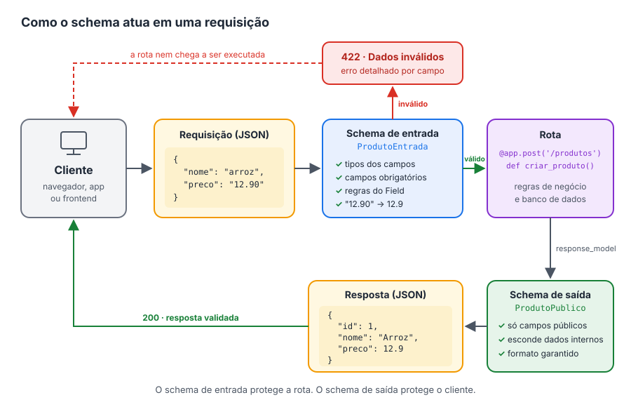

# <svg xmlns="http://www.w3.org/2000/svg" height="24px" viewBox="0 -960 960 960" width="24px" fill="#e3e3e3"><path d="M190-360h70q17 0 28.5-11.5T300-400v-200h-60v190h-40v-50h-50v60q0 17 11.5 28.5T190-360Zm177 0h60q17 0 28.5-11.5T467-400v-60q0-17-11.5-28.5T427-500h-50v-50h40v20h50v-30q0-17-11.5-28.5T427-600h-60q-17 0-28.5 11.5T327-560v60q0 17 11.5 28.5T367-460h50v50h-40v-20h-50v30q0 17 11.5 28.5T367-360Zm176-60v-120h40v120h-40Zm-10 60h60q17 0 28.5-11.5T633-400v-160q0-17-11.5-28.5T593-600h-60q-17 0-28.5 11.5T493-560v160q0 17 11.5 28.5T533-360Zm127 0h50v-105l40 105h50v-240h-50v105l-40-105h-50v240ZM120-160q-33 0-56.5-23.5T40-240v-480q0-33 23.5-56.5T120-800h720q33 0 56.5 23.5T920-720v480q0 33-23.5 56.5T840-160H120Zm0-80h720v-480H120v480Zm0 0v-480 480Z"/></svg> Schemas

O Schema é um recurso muito importante, quando falamos de API. Porque são classes que descrevem o formato dos dados que entram e saem dentro de uma API. Nesse nosso projeto vamos utilizar a biblioteca do **Pydantic** que já é integrada com o FastAPI.

Um schema funciona como um contrato: ele diz quais campos existem, de que tipo são e quais são obrigatórios.

Utilizando esses recursos, podemos deixar nossa API muito poderosa, melhorando a confiabilidade, a consistência e a usabilidade, deixando a compreensão clara.

Abaixo os recursos que podemos fazer com os schemas.

- Tipo de dados - (Podemos definir qual o tipo de dados pode entrar ou sair, podendo ele ser strings, números, datas, booleanos, etc)

- Relações entre elementos de dados - (É a forma como os campos e os schemas se ligam entre si)

- Campos obigatórios e opcionais ( Podemos definir quais são os itens que devem ser informados e quais são opcionais, como isso não precisamos fazer tratamento de erros ou validações o próprio pydantic e o FastAPI, já validam antes).

- Regras de validação (formatar campos, datas, intervalos, mascaras (CNPJ, CPF))

{ width="100%" }

Sabendo da importância do schema, vamos aplica-lo agora na nossa API, com a nossa primeira rota já criada.

!!! warning "Importante"
    Como o projeto vai crescer, vamos criar um diretório só para guardar
    e organizar os nossos schemas.

``` title="Estrutura do projeto" hl_lines="3 4"
src
└── comprix
    ├── schemas
    │   └── app.py
    ├── __init__.py
    └── app.py
```

!!! warning "Importante"
    Outro detalhe importante, que talvez não tenho falado antes, como estou utilizando a biblioteca poetry para gerenciar todos os meus pacotes e instalações, automáticamente ele cria o diretório **src**, onde fica os arquivos do python da API.

Observe que temos nosso diretório ***Schemas*** e dentro dele o arquivo ***app.py***, eu costumo deixar como o mesmo nome o schema para referenciar o arquivo da api (Mas você pode ficar a vontade para colocar outro nome)

## Nosso primeiro schema

Vamos escrever nosso primeiro schema. Abra o arquivo abaixo no seu editor e digite o código:

```python title="src/comprix/schemas/app.py" linenums="1" hl_lines="4 5"
from pydantic import BaseModel


class Message(BaseModel):
    message: str
```

- **Linha 1:** importamos a classe `BaseModel` da biblioteca Pydantic. Ela é a base de todos os schemas: é ela que traz a validação dos dados e permite que o FastAPI gere a documentação automaticamente.

- **Linha 4:** criamos a classe `Message`, que será o nosso schema. Ao colocar `BaseModel` entre parênteses, dizemos que `Message` **herda** de `BaseModel`, ou seja, ganha todos os recursos de validação do Pydantic sem precisarmos escrever nada a mais.

- **Linha 5:** definimos o único campo do schema: `message`, do tipo `str` (texto). Isso significa que todo dado que usar esse schema **precisa** ter um campo `message`, e o valor dele **precisa** ser um texto.

??? info "Por que não existe um `__init__`?"
    Em uma classe Python comum, precisaríamos escrever o método `__init__` para receber os valores. Com o `BaseModel`, basta declarar os campos com seus tipos que o Pydantic cria tudo isso por nós.

## Usando o schema na rota

Agora vamos dizer para a nossa rota que a resposta dela segue o formato do schema `Message`, e também qual código de status ela devolve quando dá tudo certo:

```python title="src/comprix/app.py" linenums="1" hl_lines="1 5 10"
from http import HTTPStatus

from fastapi import FastAPI

from comprix.schemas.app import Message

app = FastAPI()


@app.get('/', status_code=HTTPStatus.OK, response_model=Message)
def read_root():
    return {'message': 'Bem-vindo ao Comprix'}
```

- **Linha 1:** importamos o `HTTPStatus`, que já vem com o Python. Ele reúne todos os códigos de status HTTP com nomes legíveis: em vez de escrever o número `200`, escrevemos `HTTPStatus.OK`, o que deixa o código mais fácil de entender.

- **Linha 5:** importamos o schema `Message` que acabamos de criar. Repare que o caminho começa em `comprix`, e não em `src`: a pasta `src` só guarda o nosso pacote, ela não faz parte do nome dele.

- **Linha 10:** na definição da rota, passamos dois parâmetros novos:
    - `status_code=HTTPStatus.OK`: informa que, quando tudo der certo, a rota responde com o código **200 (OK)**.
    - `response_model=Message`: informa que a resposta sempre segue o formato do schema `Message`. A partir de agora, o FastAPI:
        - **valida** a resposta: se a função devolver algo sem o campo `message`, ocorre um erro;
        - **filtra** a resposta: qualquer campo que não esteja no schema é removido antes de chegar ao cliente;
        - **documenta** a resposta: o formato aparece no `/docs`.

??? info "Códigos de status mais comuns"
    | Código | `HTTPStatus` | Significado |
    |---|---|---|
    | 200 | `HTTPStatus.OK` | Deu tudo certo |
    | 201 | `HTTPStatus.CREATED` | Um registro foi criado |
    | 204 | `HTTPStatus.NO_CONTENT` | Deu certo, mas não há conteúdo para devolver |
    | 404 | `HTTPStatus.NOT_FOUND` | O recurso não foi encontrado |
    | 422 | `HTTPStatus.UNPROCESSABLE_ENTITY` | Os dados enviados são inválidos |

!!! tip "Veja na documentação"
    Rode o servidor com `poetry serve` e acesse <http://127.0.0.1:8000/docs>. Na rota `GET /`, a seção **Responses** agora mostra o código **200** com o formato da resposta, e o schema `Message` aparece na seção **Schemas**, no fim da página.