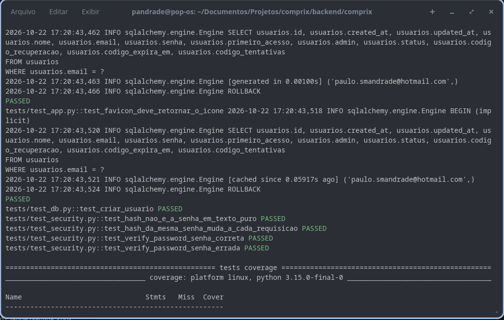
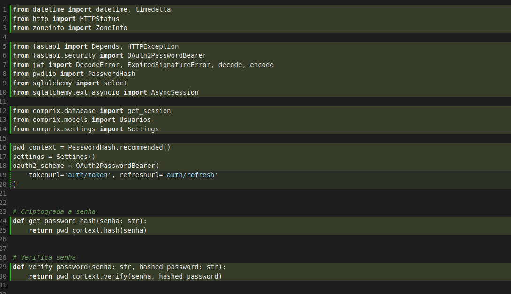

# :lucide-lock-keyhole: Senhas

## 🛠️ Hash de senhas na prática

Já vimos **por que** as senhas devem ser guardadas com hash na nossa base de
dados. Agora vamos colocar isso em prática no **COMPRIX**.

---

## 1. Instalando a dependência

Vamos usar a biblioteca **pwdlib**, recomendada pela documentação atual do
FastAPI, com suporte ao algoritmo **Argon2**:

```bash
poetry add "pwdlib[argon2]"
```

## 2. Criando o módulo `security.py`

Crie o arquivo `security.py` **dentro do pacote da aplicação**, junto com
`app.py`, `settings.py` e `database.py`:

```text
comprix/
├── src/
│   └── comprix/
│       ├── app.py
│       ├── database.py
│       ├── settings.py
│       └── security.py   👈 novo arquivo
└── tests/
```

> ⚠️ Ele fica em `src/comprix/` e não na raiz do repositório. Assim pode ser
> importado como `from comprix.security import ...`.

## 3. Escrevendo o código

```python
from pwdlib import PasswordHash

pwd_context = PasswordHash.recommended()


def get_password_hash(senha: str) -> str:
    """Gera o hash Argon2 da senha (mão única, com salt aleatório)."""
    return pwd_context.hash(senha)


def verify_password(senha: str, hashed_password: str) -> bool:
    """Confere se a senha digitada corresponde ao hash salvo no banco."""
    return pwd_context.verify(senha, hashed_password)
```

---

## 4. Entendendo cada parte

### `PasswordHash.recommended()`

Cria o objeto responsável pelos hashes, já configurado com o algoritmo
**recomendado**, que hoje é o **Argon2**. Ele é criado **uma única vez**, no
carregamento do módulo, e reaproveitado em todas as chamadas.

### `get_password_hash(senha)`

Usada no **cadastro** e na **troca de senha**. Recebe a senha em texto puro e
devolve o hash, que é o que vai para a coluna de senha da tabela `usuarios`.

### `verify_password(senha, hashed_password)`

Usada no **login**. Aplica o hash na senha digitada, usando o mesmo salt
guardado dentro do hash do banco, e compara os dois. Retorna `True` ou
`False`.

> ❗ Nunca compare hashes com `==`. Por causa do salt aleatório, a mesma senha
> gera um hash diferente a cada chamada. Use sempre `verify_password`.

---

## 5. Testando no terminal

Abra o Python com o ambiente virtual ativado e confira:

```python
>>> from comprix.security import get_password_hash, verify_password
>>> h = get_password_hash('minhasenha123')
>>> h
'$argon2id$v=19$m=65536,t=3,p=4$...'
>>> verify_password('minhasenha123', h)
True
>>> verify_password('senhaerrada', h)
False
>>> get_password_hash('minhasenha123') == h
False
```

O último resultado é `False` de propósito: é o salt funcionando. 

### Teste automatizado

Crie `tests/test_security.py`:

```python
from comprix.security import get_password_hash, verify_password


def test_hash_nao_e_a_senha_em_texto_puro():
    hash_ = get_password_hash('minhasenha')
    assert hash_ != 'minhasenha'
    assert hash_.startswith('$argon2')


def test_hash_da_mesma_senha_muda_a_cada_chamada():
    assert get_password_hash('abc') != get_password_hash('abc')


def test_verify_password_senha_correta():
    hash_ = get_password_hash('minhasenha')
    assert verify_password('minhasenha', hash_)


def test_verify_password_senha_errada():
    hash_ = get_password_hash('minhasenha')
    assert not verify_password('outrasenha', hash_)
```

```bash
pytest tests/test_security.py -v
```

### 🎉 Conforme imagens abaixo nosso testes passaram.

Terminal

{ width="800" }

pytest - Coverage 

{width="800"}

## ⏭️ Próximo passo

Com as senhas protegidas, o próximo passo é utilizar em todas as rotas 
necessárias, principalmente no login (Usuários).